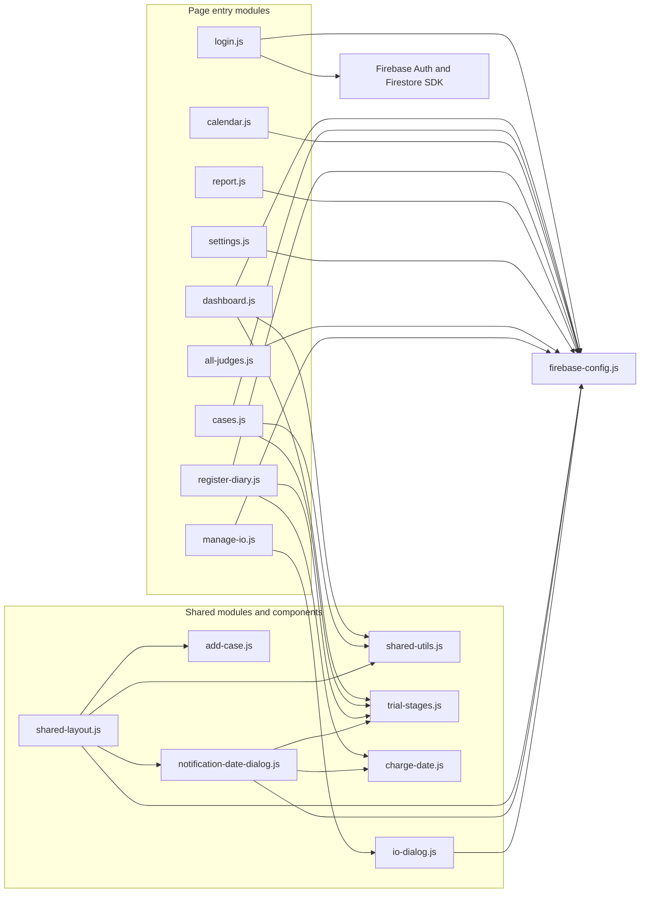
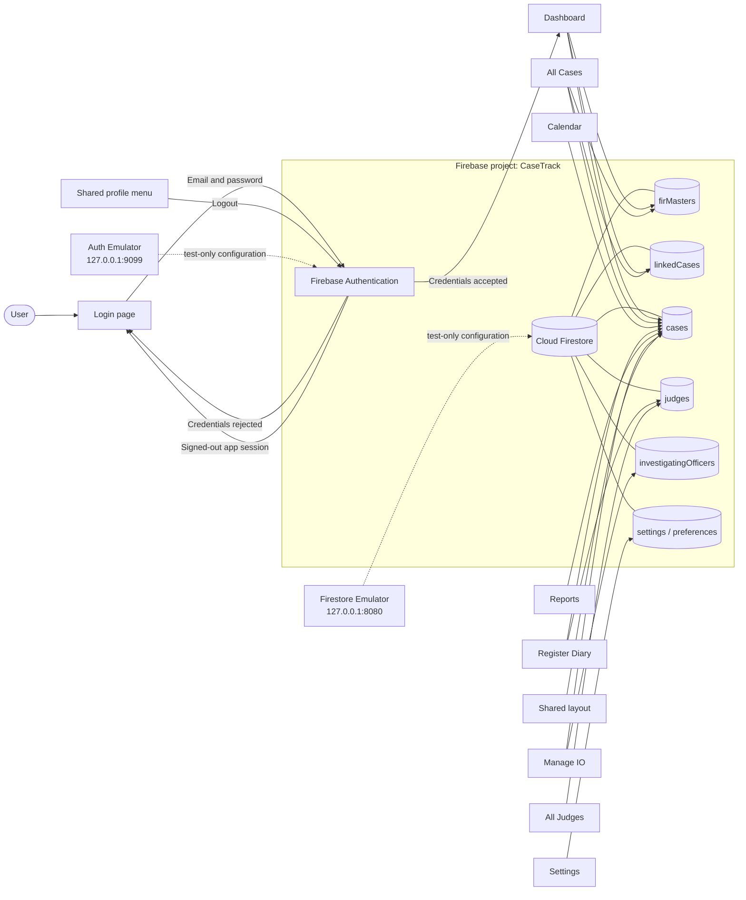
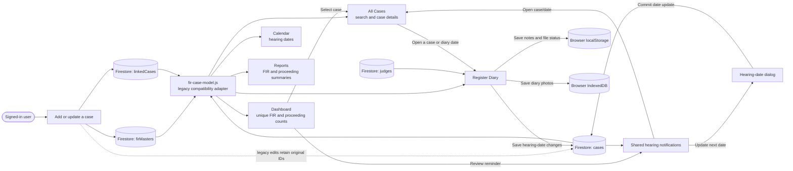
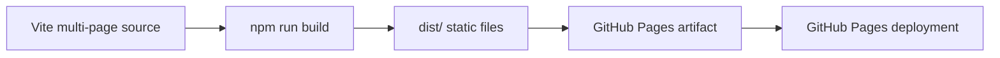

# CaseTrack Website Architecture

The diagrams below split the website architecture into smaller views so each one is easier to read.

## 1. Pages and UI components

## 2. JavaScript modules and imports

## 3. Firebase Authentication and Firestore

## 4. Data flow and case-management workflow

## 5. Build and deployment

CaseTrack is a static, multi-page Vite website. Page modules access Firebase directly; this project has no separate application server. GitHub Actions builds and deploys the contents of `dist/`. The PO Cases page filters proclaimed-offender accused entries from court proceedings.

## 6. FIR Master and proceeding data model

- `firMasters/{firMasterId}` stores one verified FIR identity and FIR-level fields. New master IDs are Firestore document IDs and remain stable.
- `linkedCases/{proceedingId}` stores new court proceedings and UCR reports. Each new record has one `firId` and `firMasterId` pointing to its FIR Master. Lower Court commitments create a separate Sessions Court record and predecessor/successor IDs; the source record remains in place.
- `cases/{legacyId}` remains readable and editable for compatibility. Existing document IDs, hearing histories, and other references are retained. A user can explicitly verify and link an exact FIR number/year/police-station legacy group; that action adds relationship fields and preserves the prior `firId` in `legacyFirId`.
- `assets/js/fir-case-model.js` combines master-only FIRs, linked records, and legacy cases for page readers. It keeps collection names with records so edits and hearing-date writes reach the original document. Failed collection reads surface as errors instead of being treated as an empty result.
- `assets/js/fir-status.mjs` normalizes FIR status labels and calculates FIR status separately from proceeding status. Active proceedings yield `UT`; all applicable proceedings disposed yields `Disposed`; a committed predecessor is excluded only when its successor relationship exists. With no court proceeding, UCR details or the saved FIR status are retained, otherwise the status is `UI`.

No bulk migration is part of the application flow. A verified migration of older records should be a separately reviewed and reversible operation. This repository contains emulator test rules but no production Firestore rules file; production access to `firMasters` and `linkedCases` must be verified before deployment.
