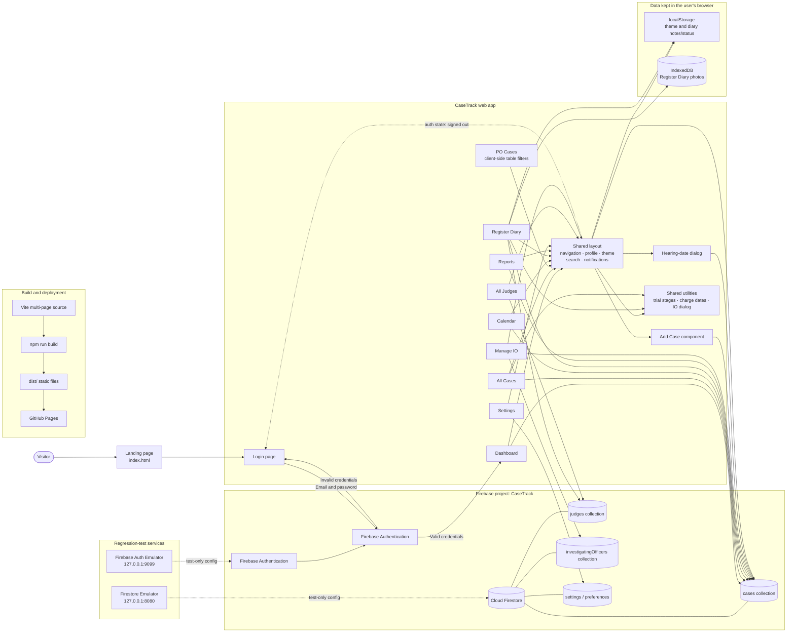

# CaseTrack Website Architecture

The app is a static, multi-page Vite website. Page-specific JavaScript talks directly to Firebase; there is no separate application server in this project. The PO Cases page currently filters its page-provided rows in the browser.
