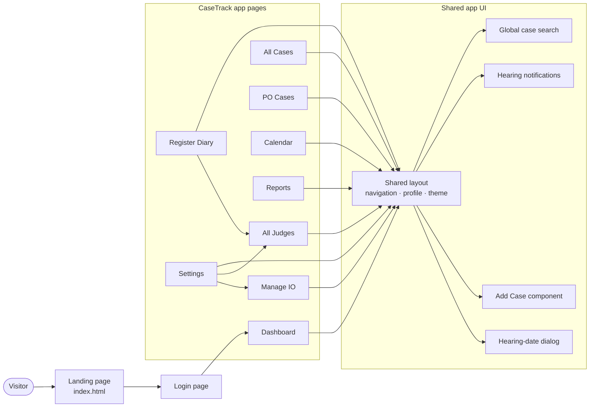
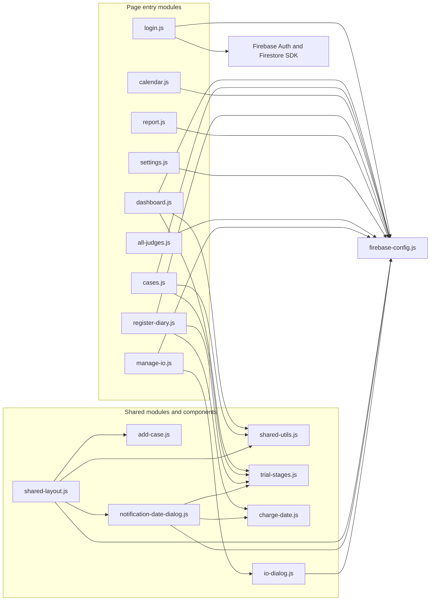
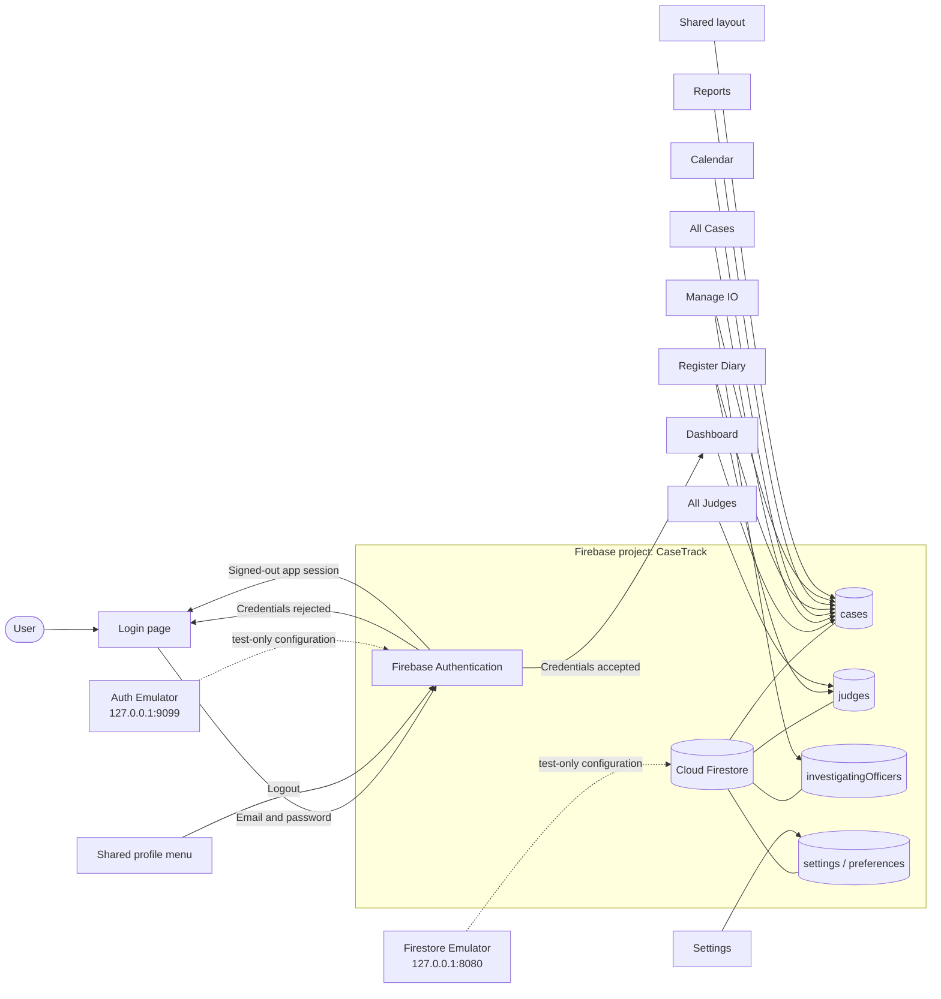
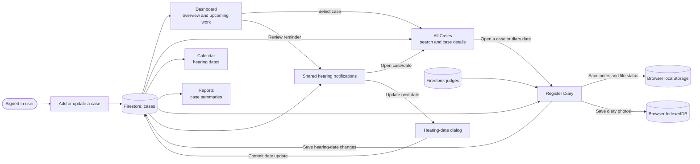
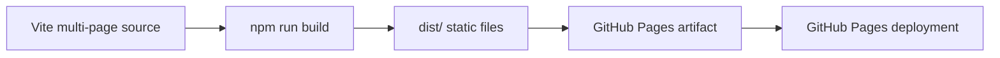

# CaseTrack Website Architecture

The diagrams below split the website architecture into smaller views so each one is easier to read.

## 1. Pages and UI components

## 2. JavaScript modules and imports

## 3. Firebase Authentication and Firestore

## 4. Data flow and case-management workflow

## 5. Build and deployment

CaseTrack is a static, multi-page Vite website. Page modules access Firebase directly; this project has no separate application server. GitHub Actions builds and deploys the contents of `dist/`. PO Cases currently filters the rows provided by its page in the browser.
