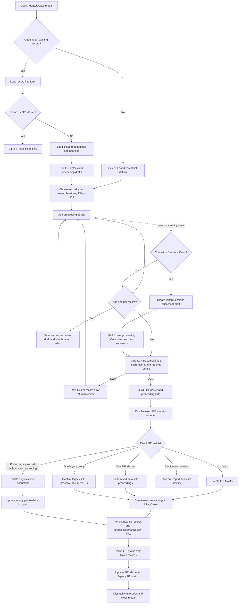
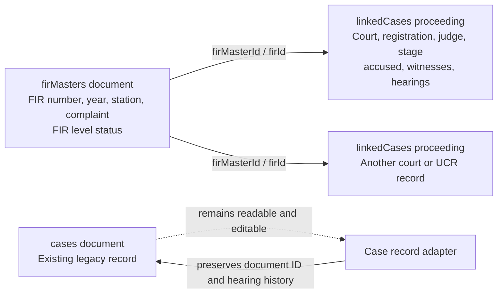
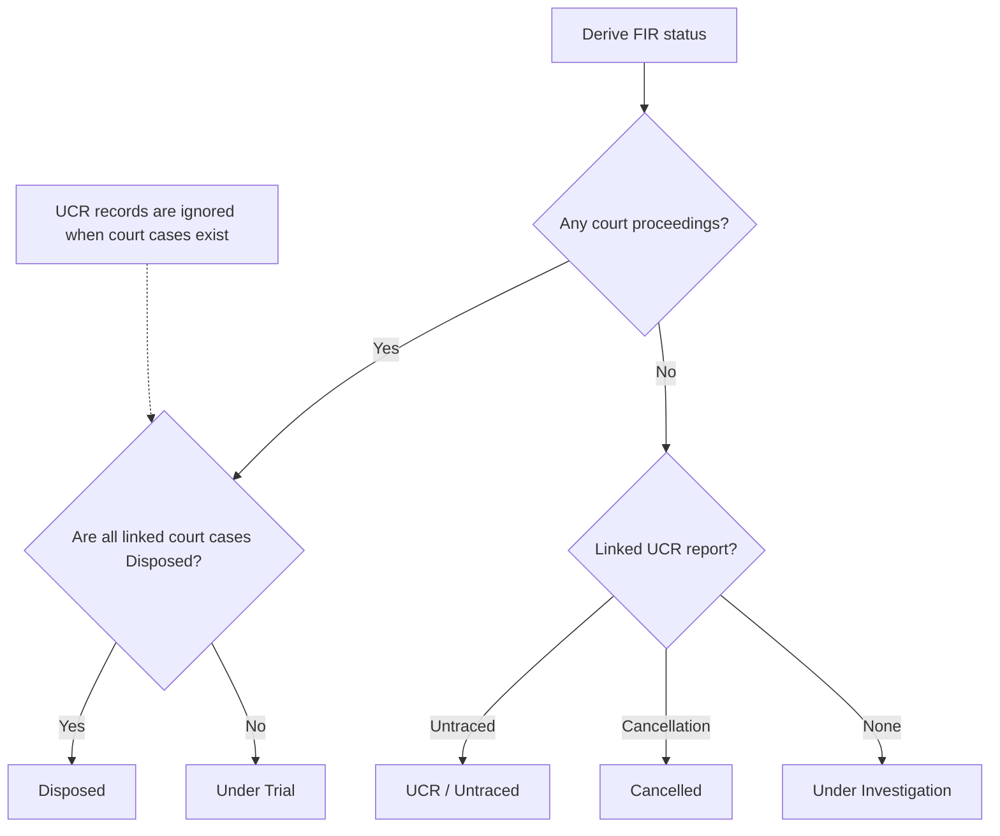
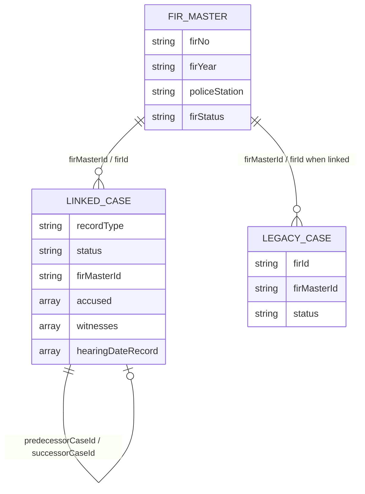

# CaseTrack Add/Edit Case Modal Flow

This diagram documents the Add/Edit Case form in `components/add-case/add-case.js` and its FIR Master / linked proceeding behavior.



## Data ownership



## Status decision



UCR records require `ucrNumber`, `report_type`, and `ucr_dod`. FIR Status is a read-only display derived from linked records. Every linked court case is checked, including a committed predecessor: it must be marked Disposed before the FIR can become Disposed.

## Firestore data structure

The modal separates information that belongs to the FIR from information that belongs to each court/UCR record. Firestore document IDs are generated by Firestore and are not duplicated as `id` fields in stored documents.

### 1. `firMasters/{firMasterId}` — one document per FIR

This is the canonical FIR-level record. It can exist even before any court proceeding is registered. `fileNo` is the human-readable physical file number, derived from FIR number and the last two digits of FIR year (for example, `23/25`). It is separate from `firId`, which is the FIR Master document ID used as a relationship key on linked records.

```json
{
  "firNo": "42",
  "firYear": "2025",
  "fileNo": "42/25",
  "firDate": "14/02/2025",
  "firStatus": "UT",
  "policeStation": "OSM",
  "underSection": "323/325/34 IPC",
  "crimeHead": "Assault",
  "incidentDate": "13/02/2025",
  "incidentPlace": "Example location",
  "complainantName": "Example complainant",
  "complainantFatherName": "Example parent",
  "complainantMobile": "9000000000",
  "complainantAddress": "Example address",
  "createdAt": "Firestore Timestamp",
  "updatedAt": "Firestore Timestamp"
}
```

`firStatus` is stored using canonical values: `UI` (Under Investigation), `UT` (Under Trial), `Disposed`, `UCR` (Untraced), or `Cancelled`. The Add/Edit modal displays the readable label in a read-only field; the user changes the underlying records and the app derives this value. Do not treat a typed display label as a separate manually editable status.

### 2. `linkedCases/{caseRecordId}` — one document per proceeding or UCR report

Every record links back to the master using the stable FIR Master document ID in both `firMasterId` and `firId`. `recordType` identifies its shape: `lower`, `session`, `jjb`, or `ucr`.

Court proceeding example:

```json
{
  "firMasterId": "fir-master-document-id",
  "firId": "fir-master-document-id",
  "fileNo": "42/25",
  "recordType": "lower",
  "status": "UT",
  "courtType": "Lower Court",
  "regPrefix": "CHI",
  "regNo": "123",
  "regYear": "2025",
  "regDate": "20/03/2025",
  "courtName": "Example Court",
  "courtNumber": "2",
  "judgeCourtType": "JMFC",
  "judgeName": "Example Judge",
  "judgeId": "judge-document-id",
  "judgeDisplayName": "Example Judge, JMFC",
  "challanDate": "10/03/2025",
  "chargeDate": "15/04/2025",
  "nextDate": "20/05/2025",
  "trialStage": "Evidence",
  "isDecided": false,
  "decisionDate": "",
  "judgement": "",
  "ioId": "io-document-id",
  "ioRank": "Inspector",
  "ioName": "Example IO",
  "ioBeltno": "1001",
  "iomobileNo": "9000000001",
  "highlighted": false,
  "predecessorCaseId": "",
  "successorCaseId": "",
  "accused": [],
  "witnesses": [],
  "hearingDateRecord": [
    { "id": "hearing-1", "kind": "next", "date": "2025-05-20", "trialStage": "Evidence" }
  ],
  "ucrNumber": "",
  "report_type": "",
  "ucr_dod": "",
  "createdAt": "Firestore Timestamp",
  "updatedAt": "Firestore Timestamp"
}
```

`status` here is the **individual proceeding status**, separate from the FIR Master `firStatus`. Court proceeding values include `UT`, `UI`, `Disposed`, and `Committed`. A linked predecessor/successor pair uses `predecessorCaseId` and `successorCaseId` document IDs; the predecessor remains part of the court-case status decision.

UCR report example:

```json
{
  "firMasterId": "fir-master-document-id",
  "firId": "fir-master-document-id",
  "fileNo": "42/25",
  "recordType": "ucr",
  "status": "UCR",
  "courtType": "",
  "ucrNumber": "UCR/18/2025",
  "report_type": "Untraced",
  "ucr_dod": "30/06/2025",
  "predecessorCaseId": "",
  "successorCaseId": "",
  "hearingDateRecord": [],
  "createdAt": "Firestore Timestamp",
  "updatedAt": "Firestore Timestamp"
}
```

`report_type` is `Untraced` or `Cancelled`. The UCR report fields are stored on the UCR record, not as a court proceeding. If any court case is linked, UCR records do not affect FIR status.

### 3. Nested proceeding details

`accused` and `witnesses` are arrays embedded in each court proceeding document.

```json
{
  "accused": [
    {
      "name": "Example accused",
      "fatherName": "Example parent",
      "mobile": "9000000002",
      "arrested": false,
      "arrestDate": "",
      "custodyStatus": "",
      "bailDate": "",
      "poStatus": false,
      "poDate": "",
      "address": "Example address"
    }
  ],
  "witnesses": [
    {
      "name": "Example witness",
      "status": "",
      "examined": false,
      "examinedDate": ""
    }
  ]
}
```

`hearingDateRecord` also lives on the individual court record. Each entry uses `{ id, kind, date, trialStage }`; dates are normalized to `YYYY-MM-DD`. The newest upcoming entry may also be summarized in `nextDate` and `trialStage`, and `chargeDate` is derived from hearing history.

### 4. Legacy `cases/{caseRecordId}` documents

Existing records continue to be read and edited in the `cases` collection with their original document IDs so references and hearing histories remain valid. `fileNo` stores the human-readable physical file number. Before a legacy record is explicitly linked, it may have no `firMasterId`; its old `firId` may not be a Firestore master document ID. Linking adds the new `firMasterId`/`firId` relationship, stores `fileNo`, and preserves the prior value as `legacyFirId`. Firestore document IDs and `firId` relationship semantics are not changed by the File No field. The UI adapter adds `_collectionName` when loading records; that is runtime metadata, not a Firestore field.

### Relationships at a glance


