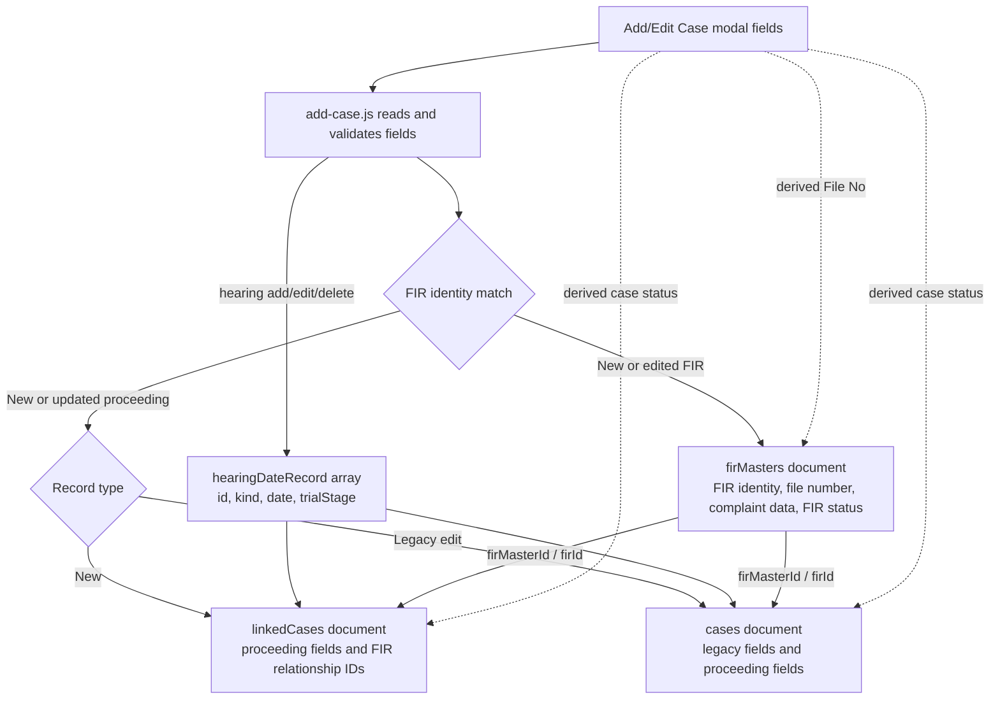

# Add/Edit Case field reference

This document maps the current modal in `components/add-case/add-case.html` to its browser logic and Firestore writes in `components/add-case/add-case.js` and `assets/js/fir-case-model.js`. It describes the current code; values marked **derived**, **snapshot**, or **not saved** are not independent Firestore inputs.

## Data flow

**Collections and identifiers:** `firMasters` holds FIR-level data. Court and UCR records are created in `linkedCases`; existing legacy records continue to be updated in `cases`. The Firestore document ID is generated by Firestore. For linked records, `firMasterId` and `firId` point to the FIR Master document ID. `fileNo` is a human-readable value and is not the document ID.

## A. Field attributes

`—` means the field does not have that static HTML attribute. Repeated accused and witness controls are cloned by JavaScript; the attributes shown are those of each repeated control.

| UI label | HTML `id` | HTML `name` | Type / options | Placeholder or initial value | Static constraints and notable attributes |
|---|---|---|---|---|---|
| File No | `fileNo` | `fileNo` | text | `Auto-generated` | `readonly`; not required |
| FIR Status | `fir_Status` | `fir_Status` | text | `Under Investigation` | `readonly` |
| FIR Number | `firno` | `firno` | number | `Enter FIR number` | `required` |
| Date of FIR | `firdate` | `firdate` | text / Flatpickr date | `Pick FIR Date` | `readonly`, `required`; picker opens on click |
| FIR Year | `firyear` | `firyear` | number | `YYYY` | `readonly`, `required` |
| Under Section | `undersection` | `undersection` | text / autocomplete | `e.g. 323/325/34 IPC` | `required`, `autocomplete=off`, combobox ARIA attributes |
| Crime Head | `crimehead` | `crimehead` | text / searchable select | `Select or search Crime Head` | `maxlength=200`, `autocomplete=off`, combobox ARIA attributes |
| Police Station | `policestation` | `policestation` | text | `OSM` | `readonly` |
| Incident Date | — | `incident_date` | text / Flatpickr date | `Pick Incident Date` | `readonly`; picker opens on click |
| Incident Place | — | `incident_place` | text | `Enter incident location` | — |
| Complainant Name | — | `complainant_name` | text | `Enter full name` | — |
| Complainant Father's Name | — | `complainant_father_name` | text | `Enter full name` | — |
| Mobile Number (complainant) | — | `complainant_mobile` | tel | `10 digit mobile number` | `maxlength=10` |
| Complainant Address | — | `complainant_address` | textarea | `Enter complete address` | `rows=3` |
| Case Status | `casestatus` | `casestatus` | select: `UT` Under Trial; `Disposed`; `Committed` | `UT` selected | `required`, `disabled`; `form=caseForm` |
| Court Type | `courttype` | `courttype` | select: Lower Court, Session Court, JJB, High Court | blank placeholder | `required`; `form=caseForm` |
| Registration prefix | `regprefix` | `regprefix` | text | `CHI` | `maxlength=12`, `autocomplete=off`, ARIA suggestions attributes |
| Registration number | `regnumber` | `regnumber` | number | `Number` | — |
| Registration year | `regyear` | `regyear` | number | `Year` | — |
| Registration Date | `regdate` | `regdate` | text / Flatpickr date | `Pick Registration/PC Date` | `readonly`; picker opens on click |
| Court No. & Name (selector) | `caseJudgeSelect` | — | select populated from judge records | blank placeholder | `aria-describedby=judgeSelectStatus`; selection itself is not submitted |
| Judge ID (hidden snapshot) | `caseJudgeId` | `judgeId` | hidden | — | — |
| Judge display name (hidden snapshot) | `caseJudgeDisplayName` | `judgeDisplayName` | hidden | — | — |
| Court number (hidden snapshot) | `caseCourtNumber` | `courtNumber` | hidden | — | — |
| Judge court type (hidden snapshot) | `caseJudgeCourtType` | `judgeCourtType` | hidden | — | — |
| Judge name (hidden snapshot) | `caseJudgeName` | `judgeName` | hidden | — | — |
| Court name (hidden snapshot) | `courtnan` | `courtnan` | hidden | — | — |
| Date of Challan | `challandate` | `challandate` | date (runtime Flatpickr text input) | `Pick Challan Date` | — |
| Date of Charge | `chargedate` | `chargedate` | text / Flatpickr date | `Pick Charge-sheet Date` | `readonly`, `aria-readonly=true`; picker opens on click |
| Hearing Date editor | `nextDateStageDate` | — | text / Flatpickr date | `Select date` | `readonly`, `aria-label=Hearing Date`; temporary editor, picker opens on click |
| Trial Stage editor | `nextDateStageTrial` | — | select populated by `assets/js/trial-stages.js` | `Select Trial Stage` | `aria-label=Trial Stage`; temporary editor |
| Next Date snapshot (hidden) | `caseNextDateValue` | `nextdate` | hidden | — | — |
| Trial Stage snapshot (hidden) | `caseTrialStageValue` | `trial_stage` | hidden | — | — |
| UCR Number | `ucrNumber` | `ucrNumber` | text | `Enter UCR number` | initially `disabled`; enabled for UCR record |
| Report Type | `report_type` | `report_type` | select: Untraced, Cancelled | `Select Report Type` | initially `disabled`; enabled for UCR record |
| Date of Disposed (UCR) | `ucr_dod` | `ucr_dod` | text / Flatpickr date | `Select date` | `readonly`, `disabled` initially; enabled for UCR record, picker opens on click |
| Investigating Officer selector | `caseIoSelect` | — | select populated from IO records | `Select Investigating Officer` | `aria-describedby=ioSelectStatus`; selection itself is not submitted |
| IO ID (hidden snapshot) | `caseIoId` | `ioId` | hidden | — | — |
| IO Rank (hidden snapshot) | `iorank` | `iorank` | hidden | — | — |
| IO Name (hidden snapshot) | `ioname` | `ioname` | hidden | — | — |
| IO Belt No. (hidden snapshot) | `ioBeltno` | `ioBeltno` | hidden | — | — |
| IO Mobile No. (hidden snapshot) | `iomobileNo` | `iomobileNo` | hidden | — | — |
| Accused Name | — | `accused_name[]` | text | `Full name` | repeated; no static `id` |
| Accused Father's Name | — | `accused_father_name[]` | text | `Father's name` | repeated; no static `id` |
| Accused Mobile Number | — | `accused_mobile[]` | tel | `10 digit mobile number` | repeated; `maxlength=10` |
| Arrest Status | — | `arrested[]` | checkbox, value `yes` | unchecked | repeated; class `arrested` |
| Arrest Date | — | `arrestingdate[]` | text / Flatpickr date | `Pick Arresting Date` | repeated; `readonly`, initially `disabled`; class `arrestingdate`; picker opens on click |
| Custody Status | — | `custody_status[]` | select: bailed_police, bailed_court, jc, pc | blank placeholder | repeated; initially `disabled`; class `custody-status` |
| Bail Date | — | `baildate[]` | text / Flatpickr date | `Pick Bail Date` | repeated; `readonly`, initially `disabled`; class `baildate`; picker opens on click |
| Proclaimed Offender | — | `po_status[]` | checkbox, value `yes` | unchecked | repeated; class `po-status` |
| PO V.O.D | — | `po_date[]` | text / Flatpickr date | `Pick PO V.O.D` | repeated; `readonly`, initially `disabled`; class `po-date`; picker opens on click |
| Accused Address | — | `accused_address[]` | textarea | `Enter complete address` | repeated; `rows=3` |
| Witness Name | — | `witness_name[]` | text | `Full name` | repeated; no static `id` |
| Witness Status | — | `witness_status[]` | select: blank/Pending, Chief, Cross, Given Up | blank option | repeated |
| Witness Examined | — | `witness_examined[]` | checkbox, value `yes` | unchecked | repeated; class `examined-checkbox` |
| Witness Examined Date | — | `witness_examined_date[]` | text / Flatpickr date | `Pick Examined Date` | repeated; `readonly`, initially `disabled`; class `examined-date`; picker opens on click |
| Total Witness | `totalWitness` | `total_witness` | number | `0` | `readonly`; computed display |
| Witness Examined | `examinedWitness` | `examined_witness` | number | `0` | `readonly`; computed display |
| Witness Left | `leftWitness` | `left_witness` | number | `0` | `readonly`; computed display |
| Is this case decided? | `is_decided` | `is_decided` | checkbox, value `yes` | unchecked | — |
| Date of Decision | `dod_date` | `dod_date` | text / Flatpickr date | `Pick Decision Date` | `readonly`, initially `disabled`; shown when decided is checked; picker opens on click |
| Judgement | `judgement` | `judgement` | text | `Enter judgement or decision` | `maxlength=500`; initially `disabled`; shown when decided is checked |
| Highlighted Case | `highlightcase` | `highlightcase` | checkbox, value `yes` | unchecked | — |

Buttons such as Add/Remove Accused, Add Witness, Add Hearing, Commit to Sessions Court, Reset, Cancel, and Save are actions, not data fields. Their behavior is described below where they change saved data.

## B. Per-field logic and Firestore names

### FIR Master fields

| UI field(s) | Logic applied | Firestore location and saved name |
|---|---|---|
| File No (`fileNo`) | `updateFileNo()` derives `${FIR Number}/${last two digits of FIR Year}`; FIR Year comes from Date of FIR. Read-only. | `firMasters.fileNo`; copied onto proceeding records. This is a display/file identifier, not the Firestore document ID. |
| FIR Status (`fir_Status`) | Read-only display. Derived from linked proceedings using `deriveFirStatus()` after save/load. Initial display is `Under Investigation`. | `firMasters.firStatus`; after proceedings are saved, the Master is updated with derived `firStatus` and `updatedAt`. |
| FIR Number (`firno`) | Required; participates in exact identity matching with year and police station. | `firMasters.firNo`; also present on legacy `cases` via legacy shared fields. Linked `linkedCases` records receive the Master relationship and load FIR-level data through the model adapter. |
| Date of FIR (`firdate`) | Required; change recalculates FIR Year and File No. | `firMasters.firDate`; also included in legacy shared fields. |
| FIR Year (`firyear`) | Read-only, required; derived from FIR Date, then used for File No and identity matching. | `firMasters.firYear`; also included in legacy shared fields. |
| Under Section (`undersection`) | Required; autocomplete from saved suggestions; raw text is persisted. | `firMasters.underSection`; also included in legacy shared fields. |
| Crime Head (`crimehead`) | Searchable master-list control; selected/new text is saved to the shared crime-head list as well as the FIR data. | `firMasters.crimeHead`; also included in legacy shared fields. |
| Police Station (`policestation`) | Read-only, current UI default `OSM`; part of exact FIR identity matching. | `firMasters.policeStation`; also included in legacy shared fields. |
| Incident Date (`incident_date`) | Optional. | `firMasters.incidentDate`; also included in legacy shared fields. |
| Incident Place (`incident_place`) | Optional. | `firMasters.incidentPlace`; also included in legacy shared fields. |
| Complainant Name (`complainant_name`) | Optional. | `firMasters.complainantName`; also included in legacy shared fields. |
| Complainant Father's Name (`complainant_father_name`) | Optional. | `firMasters.complainantFatherName`; also included in legacy shared fields. |
| Mobile Number (`complainant_mobile`) | Optional; input length capped at 10 characters in HTML. | `firMasters.complainantMobile`; also included in legacy shared fields. |
| Complainant Address (`complainant_address`) | Optional, multiline. | `firMasters.complainantAddress`; also included in legacy shared fields. |

### Proceeding and UCR fields

| UI field(s) | Logic applied | Firestore location and saved name |
|---|---|---|
| Case Status (`casestatus`) | UI is disabled and defaults to `UT`. For court records, saved status is derived from the latest saved hearing trial stage: `Committed` → `Committed`; `Disposed` → `Disposed`; otherwise `UT`. A committed lower proceeding also gets `successorCaseId`. UCR records force status `UCR`. | `linkedCases.status`; for edited legacy records, `cases.status`. Status values include `UT`, `Disposed`, `Committed`, and `UCR`. |
| Court Type (`courttype`) | Required for non-UCR records. New record type preselects Lower Court, Session Court, or JJB; user can select from the list, which also includes High Court. | `linkedCases.courtType`; legacy updates use `cases.courtType`. |
| Registration prefix/number/year (`regprefix`, `regnumber`, `regyear`) | Registration number is assembled from three distinct fields; prefix defaults to `CHI`. | `regPrefix`, `regNo`, `regYear` on `linkedCases` or `cases`. |
| Registration Date (`regdate`) | Optional date. | `regDate` on `linkedCases` or `cases`. |
| Court No. & Name (`caseJudgeSelect`) and hidden judge/court snapshots | Selection applies a snapshot to the hidden fields. The visible selector has no `name`; hidden fields carry stable judge ID, court number/type/name, and display name. | `judgeId`, `judgeDisplayName`, `courtNumber`, `judgeCourtType`, `judgeName`, `courtName` on `linkedCases` or `cases`. |
| Date of Challan (`challandate`) | Optional date. | `challanDate` on `linkedCases` or `cases`. |
| Date of Charge (`chargedate`) | Read-only; calculated by `latestChargeDate()` from hearing history entries whose stage is Charge. | `chargeDate` on `linkedCases` or `cases`. |
| Hearing Date editor (`nextDateStageDate`) | Temporary date editor. Add/Update Hearing validates the date, labels it previous/next based on today, and adds or replaces a saved hearing record. | Entry is stored in `hearingDateRecord[]` as `date` in `YYYY-MM-DD` format; the current next hearing is also summarized as `nextDate`. |
| Trial Stage editor (`nextDateStageTrial`) | Options come from `TRIAL_STAGES`; selection is attached to a hearing record. Latest stage drives Case Status. | Entry is stored in each `hearingDateRecord[].trialStage`; next-stage snapshot is `trialStage`. |
| Next Date and Trial Stage hidden snapshots (`nextdate`, `trial_stage`) | Auto-updated from the earliest future hearing. These are compatibility/display summaries, while the full history is the `hearingDateRecord` array. | `nextDate`, `trialStage` on `linkedCases` or `cases`. |
| UCR Number (`ucrNumber`) | Required for UCR records; UCR record type is selected through “+ UCR Report”. | `ucrNumber` on `linkedCases` or `cases`; `recordType` is `ucr`. |
| Report Type (`report_type`) | Required for UCR records; options Untraced or Cancelled. | `report_type` on `linkedCases` or `cases`; legacy reads may fall back to `ucrType`. |
| Date of Disposed (`ucr_dod`) | Required for UCR records; enabled only for UCR. | `ucr_dod` on `linkedCases` or `cases`; legacy reads may fall back to `ucrDisposedDate`. |
| Investigating Officer selector and hidden IO snapshots | Selector has no `name`; choosing an officer fills hidden snapshot values. | `ioId`, `ioRank`, `ioName`, `ioBeltno`, `iomobileNo` on `linkedCases` or `cases`. |
| Is this case decided? (`is_decided`) | Checkbox is read by checked state, not by string value. Controls visibility/enabling of decision fields. | `isDecided` boolean on `linkedCases` or `cases`. |
| Date of Decision (`dod_date`) | Optional; enabled when Is this case decided is checked. | `decisionDate` on `linkedCases` or `cases`. |
| Judgement (`judgement`) | Optional; enabled when Is this case decided is checked; capped at 500 characters. | `judgement` on `linkedCases` or `cases`. |
| Highlighted Case (`highlightcase`) | Checkbox is converted to a boolean. | `highlighted` boolean on `linkedCases` or `cases`. |

### Repeated accused fields

Each accused card is serialized into one object in the Firestore `accused` array. Checkbox values become booleans; field strings are trimmed. Arrest Date and Custody Status are enabled only when Arrest Status is checked; Bail Date is enabled only for bail custody states; PO V.O.D is enabled only when Proclaimed Offender is checked.

| HTML name | Firestore property in `accused[]` | Logic |
|---|---|---|
| `accused_name[]` | `name` | Text, trimmed. |
| `accused_father_name[]` | `fatherName` | Text, trimmed. |
| `accused_mobile[]` | `mobile` | Text, trimmed; HTML max length 10. |
| `arrested[]` | `arrested` | Checkbox boolean. |
| `arrestingdate[]` | `arrestDate` | Date string, trimmed; enabled when arrested. |
| `custody_status[]` | `custodyStatus` | Select value; enabled when arrested. |
| `baildate[]` | `bailDate` | Date string, trimmed; enabled only for bailed by Police/Court. |
| `po_status[]` | `poStatus` | Checkbox boolean. |
| `po_date[]` | `poDate` | Date string, trimmed; enabled when PO is checked. |
| `accused_address[]` | `address` | Textarea, trimmed. |

### Repeated witness fields and computed totals

Each witness row is serialized into one object in the Firestore `witnesses` array. Examined Date is enabled only when Examined is checked.

| HTML name / id | Firestore property or result | Logic |
|---|---|---|
| `witness_name[]` | `witnesses[].name` | Text, trimmed. |
| `witness_status[]` | `witnesses[].status` | Select value, trimmed. |
| `witness_examined[]` | `witnesses[].examined` | Checkbox boolean. |
| `witness_examined_date[]` | `witnesses[].examinedDate` | Date string, trimmed; enabled when examined. |
| `totalWitness` / `total_witness` | Not saved | Computed number of rows with a non-empty witness name. |
| `examinedWitness` / `examined_witness` | Not saved | Computed number of named witnesses with Examined checked. |
| `leftWitness` / `left_witness` | Not saved | Computed as total named witnesses minus examined. |

## Persistence details and caveats

- A new FIR Master is written to `firMasters` by `saveFirMaster()`. The generated Firestore document ID is returned and used as the linked relationship ID.
- Newly added proceeding records are written to `linkedCases`; existing records retain their collection and document IDs when edited. Legacy records in `cases` receive the FIR-level shared snapshot fields as well as proceeding fields.
- `linkedCases` proceedings store the FIR relationship fields (`firMasterId`, `firId`) and `fileNo`; FIR-level fields are overlaid by `loadCaseRecords()` from `firMasters` at read time. Legacy `cases` writes retain the shared FIR fields for backward compatibility.
- Create/update writes add or refresh `createdAt`/`updatedAt`. Editing a linked record clears obsolete legacy fields `beltNo`, `mobileNo`, `registerDiaryDaterecords`, and `registerDiaryDateRecords`.
- `hearingDateRecord` is persisted on each proceeding with entries `{ id, kind, date, trialStage }`. Hearing editor controls themselves have no `name`; the code synchronizes them into the hidden snapshots and history array.
- Date inputs are made read-only by `initDatePickers()` to prevent typing. Flatpickr opens from the input click; date values use `d/m/Y` in the UI.
- The witness totals are not included in `courtFields`, so they are display-only. The selected judge and IO dropdowns are also not submitted directly; their hidden snapshot fields are what get saved.
- This mapping is source-based, not a live Firestore inspection. Actual deployed rules or data may differ from repository code.

## Source references

- Modal fields and static HTML attributes: `components/add-case/add-case.html`
- Read/load mappings, draft fields, validation, conditional behavior, and save payload: `components/add-case/add-case.js`
- FIR collection names, data adapter, and Master document writes: `assets/js/fir-case-model.js`
- Trial stage choices and normalization: `assets/js/trial-stages.js`
