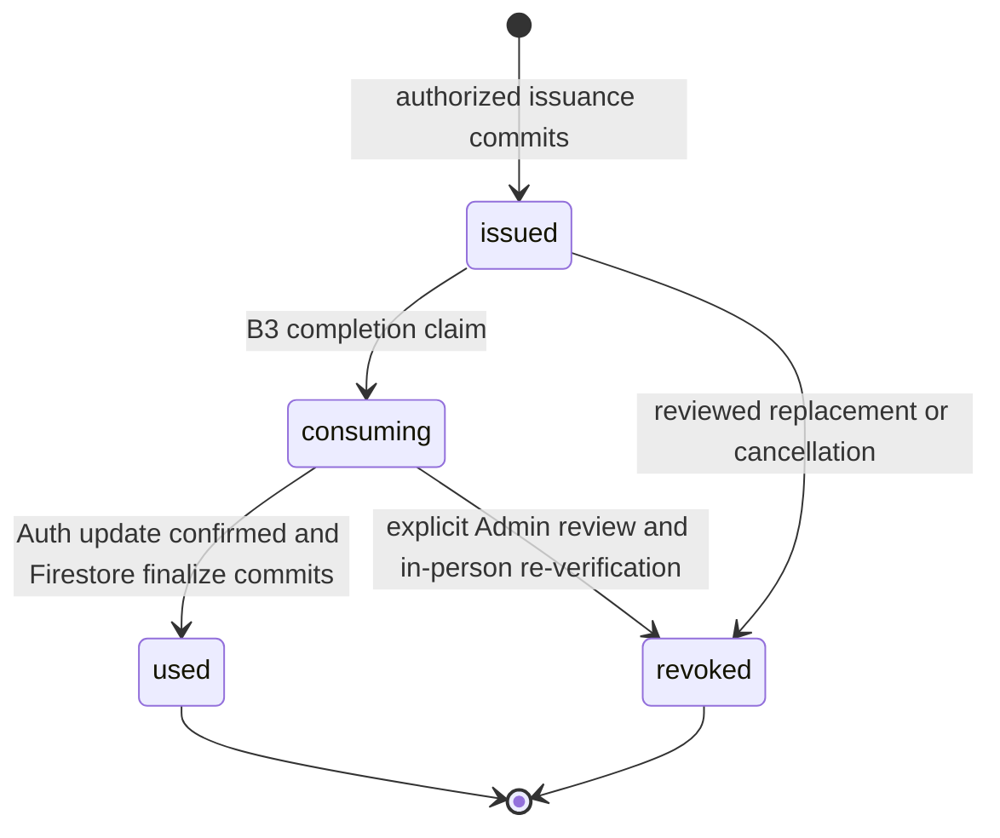
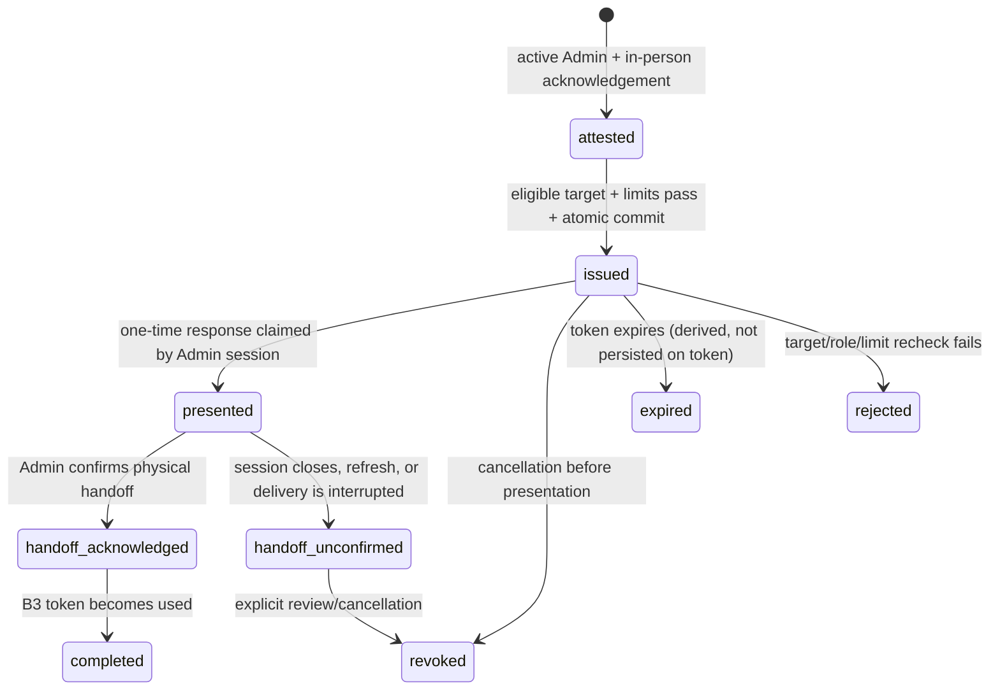

# Password Setup B4.1 — Security Architecture and Storage Approval

**Status:** Design only. No application code, schema, Rules, indexes, dependencies, Admin UI, or Firebase resources changed. UX-001 remains **Critical · Open**.

**Scope:** This is the B4.1 design deliverable. It reflects the owner's approved product policies for in-person verification, Admin-controlled manual handoff, security auditing, reissue/reconciliation, and Operator issuance limits. It does not authorize implementing the new storage or frontend required to enforce those policies. B4.2 and later remain gated on approval listed at the end.

## 1. Source review and discrepancies

Reviewed the current root Functions source, Admin Panel, Firebase configuration/Rules, Password Setup docs, and B1–B3 implementation/tests.

### Current source findings

- `functions/index.js` exports `validateOperatorSetupCode` and `completeOperatorPasswordSetup` as v2 HTTP Functions in `us-central1`; it also exports Admin handlers from `admin-role-management.cjs`. These are local source exports only; no deployment was inspected or performed.
- `authorizeActiveAdmin` extracts a Bearer ID token, verifies it using `verifyIdToken(token, true)` (revocation check), and reads `userRoles/{uid}` from Firestore. An Admin must have `role: "admin"`, `status: "active"`, must not require a password change, and must not carry an Operator station assignment. Client role claims are not used for this decision.
- Admin access is global. There is no per-Operator assignment or station-scoped Admin permission in the current role model. The proposed target authorization is therefore: active globally authorized Admin **and** server-verified active eligible Operator, plus an explicit in-person attestation. If product needs narrower Admin-to-Operator scope, that needs a separate role/policy design.
- A recovery-eligible target must have an existing enabled Firebase Auth account and `userRoles/{uid}` with `role: "operator"`, `status: "active"`, and `mustChangePassword: false`. No role, station, or other account field should be changed by recovery issuance.
- `operatorSetupActionCodes/{uid}` is the existing one-token-per-UID registry. `operator-email.cjs` generates 32 random bytes, stores a SHA-256 hex digest, binds `purpose`, applies a maximum 24-hour expiry, compares digests in constant time, and has `issued`, `consuming`, `used`, and `revoked` vocabulary. `register` refuses to replace `consuming`; `revoke` currently only transitions `issued → revoked`. It has no administrative operation link and cannot yet safely perform reviewed `consuming → revoked` reconciliation.
- B2's `operatorSetupRateLimits` is a persistent fixed 15-minute counter keyed by hashed IPv4 `/24` or IPv6 `/56` source prefix, shared by public validation/completion, with 30 attempts. It does not implement per-Operator rolling issuance caps, the 15-minute per-Operator issue interval, or Admin-level issuance limits.
- Current Admin auditing is limited to provisioning/role-management records and `userRoles/{uid}/history/{eventId}` for role changes. There is no recovery audit event store. Existing request journals are not a general append-only security audit.
- Firestore Admin SDK access bypasses Security Rules. `firestore.admin-panel.rules` has a final deny-all catch-all; client reads/writes to any proposed recovery collections/documents would be denied by that catch-all. No Rule change is indicated by this design.
- Firebase config declares Auth, Firestore, and Functions emulators; root `firebase.json` points Firestore at `firestore.admin-panel.rules`. Functions run Node 22. No custom index is present for this workflow.
- The Admin Panel currently lists UID, role, status, and station; it does not display the Auth email in its Users table. It has buttons for role management and `Reset temporary password`. `resetOperatorPassword` disables the account, sets `mustChangePassword`, updates Auth to a random temporary password, re-enables it, and returns that password to the UI. `operator-credentials.js` displays and copies that temporary password, clearing its input on dialog close. This is a different credential-reset workflow and must remain unchanged.
- There is no recovery UI, in-person attestation, one-time recovery-link display, or handoff acknowledgement. Existing password credential dialog behavior is not sufficient for a token-bearing recovery link. A new Admin UI and frontend authorization/session behavior are required.
- The existing token URL helper appends `uid` and `token` in the URL fragment to `OPERATOR_SETUP_URL`; the Password Setup page strips the fragment before requests. `sendOperatorSetupEmail` is not wired into operator provisioning; it accepts an API key argument and has no approved deployment binding. SendGrid and other external delivery remain out of scope.

### Documentation discrepancies to resolve

- Earlier parts of `PASSWORD-SETUP-BACKEND-ARCHITECTURE.md`, the API contract, and the test plan are historical B1/B2 planning text and still describe handlers as absent or describe known Auth rejection as releasing a claim. Current source has both B2/B3 handlers, and B3 intentionally retains every post-claim Auth error as `consuming`.
- The prior B4 gate notes in `PASSWORD-SETUP-RECOVERY-PROCEDURE.md`, `PASSWORD-SETUP-SECURITY-REVIEW.md`, the issue register, and checklist say identity verification and delivery are unapproved. The current owner instruction supersedes that specific status: in-person Admin attestation and manual Admin-controlled handoff are approved product policies. Their enforcement still requires unapproved schema and Admin UI changes.
- Several B1/B2 historical checklist and implementation-log records say no validation/completion handlers exist. Those records are historical; B2/B3 records later in the same files describe the actual current source.

## 2. Proposed architecture

### Authorization and trust boundaries

Every Admin recovery API must:

1. Require HTTPS, `POST` (or a narrowly defined authenticated `GET` for read-only status), JSON, exact fields, bounded request size, no-store response headers, and the existing exact Admin origin allowlist. CORS is not authentication.
2. Require `Authorization: Bearer <Firebase ID token>`, verify it with revocation checking, derive the actor UID only from verified claims, and re-read `userRoles/{actorUid}` for current active Admin eligibility on **every** operation. Do not trust caller role claims, client-provided Admin UID, or an earlier attestation as current authorization.
3. Validate the target UID shape, then fetch target Auth and role state server-side. Require enabled Auth account and active eligible Operator role. Never take target email, role, station, or account state from the request as authority.
4. Require explicit `verificationAcknowledged: true` for identity attestation. Set method to the fixed server-side enum `in_person`; set actor UID and verification/event timestamps from verified server context and trusted server time. A false/missing acknowledgement is rejected. The backend records an Admin's attestation; it cannot independently prove that a meeting occurred.
5. Recheck the actor and target role in the transaction that writes issuance/revocation. Auth enabled state cannot participate in a Firestore transaction; check it immediately before commit and again after commit. If the post-commit check finds the user disabled, revoke the newly issued token and record the outcome before returning a link. Completion still independently checks enabled state.

**Stolen Admin session:** `verifyIdToken(token, true)` rejects revoked ID tokens but accepts an otherwise valid stolen session until expiry/revocation. It does not enforce recent reauthentication or MFA. Require owner approval for a step-up control (recommended: recent reauthentication, ideally MFA, within five minutes) before issuance and consuming-token reconciliation. This requires an Admin UI/auth-flow change and is not silently assumed in B4.1.

### State transitions

Token registry (the existing one-document-per-UID record):



Expiry is evaluated from `expiresAt` in every validation/claim regardless of stored status; do not add an `expired` state. The existing `revoke()` helper does not support `consuming → revoked`; B4.5 needs a purpose-checked, audited administrative transition. It must clear the digest and preserve only non-sensitive failure evidence. A fresh token is issued only after the old token is durably unusable. No completion call is replayed, no claim is reset to `issued`, and no password outcome is inferred from `consuming`.

Recovery operation lifecycle:



`expired` above describes an operation-view result derived from time, not a persisted token state. A response loss after the one-time presentation claim is treated as handoff outcome unknown: never redisplay the same raw link; require review, revoke, and a fresh in-person attestation/reissue subject to limits.

## 3. Exact proposed Firestore structures — approval required

All paths below are new except the noted additive token-registry field. Admin SDK only. Existing client Rules default-deny them. Do not add Rules or indexes in the proposed shape.

### A. `operatorRecoveryOperations/{operationId}` — new collection

`operationId` is a server-generated random UUID (not a token and not an authorization secret). Proposed fields:

```text
operationId: string
actionType: "recovery_issuance" | "consuming_reissue"
state: "attested" | "issued" | "presented" | "handoff_acknowledged" |
       "handoff_unconfirmed" | "revoked" | "rejected" | "failed"
actorAdminUid: string
targetOperatorUid: string
reasonCode: "operator_lost_access" | "consuming_completion_review"
verificationMethod: "in_person"
verificationAcknowledged: true
verificationAt: Firestore Timestamp
attestationExpiresAt: Firestore Timestamp (proposed 10 minutes after verification)
createdAt: serverTimestamp
updatedAt: serverTimestamp
tokenIssuedAt: Firestore Timestamp | absent until issued
tokenExpiresAt: Firestore Timestamp | absent until issued
handoffPresentedAt: Firestore Timestamp | absent until presented
handoffAcknowledgedAt: Firestore Timestamp | absent until acknowledged
revokedAt: Firestore Timestamp | absent until revoked
safeFailureCode: allowlisted enum | absent
relatedOperationId: string | absent
```

Do not store raw token, digest, full URL, password, email, request body, bearer token, or clipboard contents here. An optional client request/idempotency key may be stored only after binding it to actor and target; it is not a credential. Operation state is mutable; each transition must also append an immutable audit event.

### B. `operatorRecoveryOperations/{operationId}/events/{eventId}` — append-only audit subcollection

Proposed fields (server written; never update/delete in application code):

```text
eventId: string
actorAdminUid: string | null (null unless verified as an active Admin)
verifiedActorUid: string | null (only from successfully verified Firebase ID token)
targetOperatorUid: string | null (only after syntactic validation)
actionType: allowlisted enum
verificationMethod: "in_person" | null
verificationAt: Firestore Timestamp | null
eventAt: serverTimestamp
outcome: "accepted" | "rejected" | "failed" | "ambiguous"
reasonCode: allowlisted non-sensitive enum
relatedOperationId: string
```

Persist a rejected attempt when a verified caller is known; never trust a forged body actor UID. Invalid/anonymous token attempts have no verifiable Admin UID, so do not write attacker-controlled target/body data to Firestore; emit only a coarse secret-free platform log/metric. Audit-write failure must fail closed for any state-changing operation. The Firestore client catch-all denies client access, but server code and service-account/IAM owners can still mutate; append-only behavior therefore also depends on code review and least-privilege operational access. Audit retention is undecided and must be approved; do not add TTL without that decision.

### C. `operatorRecoveryIssuanceLimits/{principalHash}` — new collection

Use deterministic IDs `sha256("casetrack:operator-recovery-target:v1:" + uid)` and `sha256("casetrack:operator-recovery-admin:v1:" + uid)`. Do not store the raw UID in limiter documents. Proposed fields:

```text
scope: "target" | "admin"
successfulIssuanceTimesMs: number[] (server generated, pruned to rolling 24h)
lastSuccessfulIssuanceAtMs: number | null
updatedAt: serverTimestamp
```

The list is bounded by policy (3 per target; proposed 10 per Admin) and updated under a Firestore transaction. Millisecond timestamps come from trusted server runtime time, never the client. Firestore server timestamp is also written for operational audit; transactions cannot use a server timestamp as a value for their own quota comparison. A clock-skew/correlated-region review is required before deployment.

### D. Existing `operatorSetupActionCodes/{uid}` — additive link field(s) approval required

Proposed additive `recoveryOperationId: string` on recovery-purpose records to link the current digest-only token to its operation without storing token material. For reviewed consuming revocation, use existing `status: "revoked"`, clear `tokenHash`, and retain current `attemptId`, `completionFailureStage`, and `completionFailureAt` where present. Whether to add `revokedAt`, `revokedByAdminUid`, and `revocationReasonCode` here is open; the audit event already records those facts. Prefer keeping those facts only in the operation/audit docs to minimize token-schema expansion. Initial-setup records remain unchanged. Existing `register` cannot be used blindly for a recovery replacement because it refuses `consuming` and overwrites an issued document without a complete administrative audit.

### Data volume and index implications

- Direct gets/sets by operation ID, target token UID, and hashed limiter IDs require no composite index.
- Events are read by direct operation subcollection; this avoids an audit query requiring a composite index. If product later requires cross-operation filtering by target and time, request a separately reviewed index.
- `operatorRecoveryIssuanceLimits` has two docs per issued recovery (one target, one Admin), with at most 3 and 20 timestamps respectively under the later approved limits; transaction read/write cost is bounded. Each successful issue/reissue also writes/updates operation, token registry, and audit event documents. Denied/failed attempts that need durable audit create an event write and add cost.
- Firestore rules do not need changes for Admin SDK access; current catch-all already denies clients. No index is proposed. The two new collections, audit subcollection, and token field are schema changes and are **not authorized for implementation yet**.

## 4. Proposed endpoint contracts — not implemented

All Admin endpoints require revocation-checked Firebase ID token plus active server-side Admin lookup on each call. Common controls: exact CORS allowlist; CORS is not auth; strict JSON and exact keys; maximum 4 KiB; `Cache-Control: no-store`; no request/body tracing; no token/password in logs. Error responses must not disclose whether a target UID exists. Actual Functions URLs follow the existing `us-central1` naming convention; no URL/export is added in B4.1.

### `POST /recordOperatorRecoveryVerification` — B4.2 proposal

Request:

```json
{"targetUid":"<uid>","verificationAcknowledged":true,"reasonCode":"operator_lost_access"}
```

Use an `Idempotency-Key` UUID for the operation, bound to verified actor and target. No client actor UID, role, method, timestamp, email, token, or password. Server fixes `verificationMethod` to `in_person`, captures `verificationAt`, rechecks target Auth enabled and active Operator/`mustChangePassword:false`, and writes the operation plus audit event. Proposed success `201 {"operationId":"...","verificationExpiresAt":"..."}`. Missing acknowledgement: `400 verification-required`; unauthorized/invalid ID token: `401`; authenticated non-Admin: `403`; missing/ineligible target: generic `404 operator-unavailable`; conflict/idempotency mismatch: `409`; audit/storage unavailable: `503`. No token is generated or returned in B4.2.

The ten-minute attestation lifetime is a proposed short validity window; owner confirmation is needed. Issuance must repeat all eligibility and Admin authorization checks rather than treating an attestation as lasting authority.

### `POST /issueOperatorPasswordRecovery` — B4.3 proposal, callable only with B4.4 handoff ready

Request:

```json
{"operationId":"<attested-operation-id>"}
```

The server verifies operation actor equals authenticated Admin, attestation is current and unused, target remains eligible, reason/action allows issuance, and both quotas pass. It creates a 32-byte random `password_recovery` token and URL in memory, persists only the digest, and commits token state, operation state, both quota records, and audit event atomically. Proposed first successful response is `201 {"operationId":"...","recoveryUrl":"<one-time link>","expiresAt":"..."}` with no-store; this link is returned only to the authenticated Admin UI, never to a public endpoint. A repeat request for the same operation returns `409 handoff-unavailable`; it never reconstructs or redisplays the token. Admin UI must display it once in memory and require acknowledgement after physical handoff. Do not ship this endpoint before its secure UI is ready: otherwise token exposure through raw API/devtools is an avoidable operational hazard.

Target over quota / minimum interval / Admin over quota: `429 issuance-limited` (include `Retry-After` only if it does not disclose target existence). Stale/used operation: `409 operation-unavailable`; target no longer eligible: generic `404 operator-unavailable`; transaction/audit uncertainty: `503 temporarily-unavailable`, followed by a server-side operation-status check, never a blind second issuance. A commit may have succeeded even when the response is lost; the counters remain consumed and the operation must be reviewed.

**Increment sequencing issue:** B4.3 issuance cannot safely ship separately from B4.4's one-time UI handoff. Plaintext cannot be persisted between increments, so the issuance response must reach the authorized UI exactly once. Recommend separate approval to implement B4.3 and B4.4 together, or to add an explicitly approved transient handoff design. Do not solve this by storing an encrypted/plaintext token in Firestore without a separate design.

### `POST /acknowledgeOperatorRecoveryHandoff` — B4.4 proposal

Request `{"operationId":"...","handoffAcknowledged":true}`. Authenticated actor must still match operation actor and remain active Admin. Update state once and append event; require the browser to clear in-memory link immediately after acknowledgement. Repeat is idempotent but does not return the URL. This records Admin attestation only; it cannot prove the Operator actually received or used the link.

### `GET /getOperatorRecoveryStatus?targetUid=<uid>` — B4.5 proposal

Admin-authenticated, no-store, read-only. Return only `{targetUid, state, purpose, issuedAt, expiresAt, completionFailureStage, completionFailureAt, operationId}` where state is a safe enum. Never return token hash, token, recovery URL, attempt secrets, password, or speculative password-change status. Generic unavailable response for unknown/ineligible targets. The backend must not say password changed merely because Auth update stage is absent or present.

### `POST /reviewAndRevokeOperatorRecovery` — B4.5 proposal

Request `{"operationId":"...","targetUid":"...","verificationAcknowledged":true,"reasonCode":"consuming_completion_review"}`. Require fresh in-person verification; verify actor/target again. Transactionally transition only the exact current `password_recovery` record from `consuming` to `revoked`, delete digest, preserve safe failure evidence, and append review/revocation events. Never touch Firebase Auth or assert completion. A later **newly attested** operation issues the replacement and rechecks quotas. This design makes review+revocation atomic, then new issuance a distinct operation; failure after revocation leaves the old token invalid and no replacement, which is safe to retry after limits/approval.

## 5. Issuance limits and transaction algorithm

### Policy

- Target: maximum **3 successful issuance commits per rolling 24 hours**, with at least **15 minutes between successful commits** for the same target. Count initial recovery and consuming-state reissue equally.
- Admin: maximum **20 successful issuance commits per rolling 24 hours** across all Operators, per the later approved owner policy. No permanent lockout; timestamps age out automatically. A separate request-attempt throttle for verified Admins remains a design question and must not be inferred from this successful-issuance quota.
- Apply B2's network-prefix limiter as supplementary friction if useful, but do not treat it as the target/Admin quota. Do not trust client-supplied forwarding headers; use only platform-provided source address after deployment provenance is reviewed.

### Atomic issuance

1. Verify Admin, attestation operation, target Auth enabled state, role eligibility, and current token state outside the transaction. Generate token bytes and digest in memory once per idempotent operation; never log either.
2. In one Firestore transaction, read the target role, target token, attested operation, target limiter, Admin limiter, and the relevant operation/audit references **before any writes**. Recheck actor/target role and attestation ownership/state, target token purpose/status/expiry, and compare trusted `nowMs` against pruned rolling event lists.
3. If any check fails, perform no quota/token/operation state write. Record a safe rejection audit separately (or transactionally with no successful-issuance counters); audit failure still rejects. Do not spend successful issuance allowance on denied requests.
4. If allowed, atomically revoke/invalidate prior `issued` token (or require it already be revoked after review), create/replace the registry record as `issued` with `purpose: password_recovery`, digest, issued/expiry timestamps, and operation ID; append the time to both counters; mark operation `issued`; create immutable audit event. Commit all or none.
5. Return the raw link only after commit. Claim the operation's one-time presentation state atomically so retries never return the same link. If commit/response outcome is uncertain, read operation state. If still uncertain, fail closed; never retry with a new token silently. Any confirmed token commit counts against both quotas, even if delivery acknowledgement later fails.

The Firestore transaction serializes competing attempts because every issuance for one target reads/writes that target's token and target-limit doc. The shared Admin-limit doc serializes that Admin's concurrent requests. A rejected transaction must not mutate counters. Audit event creation, token invalidation/new digest, operation state, and both counters must commit in the same issuance transaction so they cannot disagree on a confirmed commit.

### Failed/ambiguous accounting

| Outcome | Token / audit | Successful-issuance quota |
|---|---|---|
| Invalid auth, missing acknowledgement, ineligible target, or quota rejection before issuance transaction commits | No new token; safe rejection audit when verified actor is known | Not consumed |
| Firestore transaction reports definite abort before commit | Old token state unchanged; failure event if safely writable | Not consumed |
| Commit definitely succeeds | New token and audit durable | Consumed for target and Admin |
| Commit or HTTP result ambiguous | Do not issue another token; reconcile the operation doc and registry | Count if commit occurred; if storage remains unavailable, assume potentially consumed and block retry until reviewed |
| Link generated but UI response lost or handoff unacknowledged | Token may be valid; mark handoff outcome unknown, never redisplay; revoke before next issue | Consumed; minimum interval and rolling limits still apply |
| Token revoked after failed/interrupted handoff | Old token invalid; audit kept | Not refunded |
| Target disabled after commit | Completion will reject while disabled; revoke after a post-commit recheck if discovered; never change role/account fields | Consumed; no refund |
| Audit write fails | State-changing transaction must not succeed | Not consumed if transaction aborts |

## 6. Manual handoff and browser controls

Manual handoff is approved as policy, but no current Admin UI safely supports it. Proposed B4.4 behavior:

- Use a dedicated Admin-only dialog launched from an active Operator row. Before issuance, show the selected UID, Auth login email, role/status/station and the explicit in-person confirmation; backend re-fetches all authoritative fields. Current table does not show email, so this requires a reviewed Admin-only backend/UI addition. Use a read-only server-returned target summary, never request email as proof.
- Require reason enum and explicit checkbox/affirmation. For `consuming` review, require distinct review wording and fresh in-person acknowledgement; show only `consuming`, expiry, failure-stage enum/time and operation ID.
- Keep the recovery URL only in JavaScript memory/DOM for a short proposed window (five minutes maximum); never localStorage, sessionStorage, URL navigation, service-worker cache, analytics, crash reports, or logs. Set `Cache-Control: no-store`, restrictive CSP/no third-party scripts for the screen, `Referrer-Policy: no-referrer`, and clear DOM/string references on close, sign-out, session change, navigation/pagehide, timeout, or handoff acknowledgement. Verify no browser/service-worker caching of the API response.
- Provide an explicit one-time reveal/copy control and clear in-person instructions. Existing credential dialog uses clipboard copy; clipboard history/OS sync cannot be cleared reliably. If copy is approved, explain the risk and clear UI state; offer manual transcribing/scanning only if a safe no-new-dependency option is approved. Screenshots, extensions, devtools and shoulder-surfing remain possible.
- Acknowledge after handoff. If refresh, navigation, session loss, or interruption occurs before acknowledgement, do not restore the link from browser storage or return it again. Mark as unconfirmed where possible; Admin must review and revoke the old token, then create a new in-person attestation/reissue subject to limits.
- API bearer link response is visible to authorized Admin DevTools/network inspection. The endpoint must be Admin-authorized, one-time, no-store, body-redacted in logs/APM, and unavailable to public callers. This residual risk cannot be removed by CORS.

**Stop condition:** implementation requires new frontend authorization/UI changes (target identity confirmation, attestation, one-time display, acknowledgement, session-loss clearing). Current Admin UI cannot safely provide them. This must be separately approved before B4.2/B4.4 code changes.

## 7. Security analysis and mitigations

| Threat / failure | Risk | Design control and residual limit |
|---|---|---|
| Unauthorized Admin impersonation | Forged UID/role or stale/revoked session issues token | Verify Bearer ID token with revocation check and current role doc on each API; actor UID from verified claim only; no client role. Current valid stolen tokens remain risk—approve recent reauth/MFA step-up. |
| Wrong Operator selected | Admin attests for incorrect account | UI must bind action to selected UID and show server-fetched Auth email + station/status; require in-person confirmation and target UID in audit. Backend independently verifies active Operator. Current list is UID-centric and does not show email. |
| Spoofed public recovery request | Attacker requests a victim reset | Public request is never accepted as proof or as issuance input. Only authenticated Admin starts operation and attests in person. No endpoint sends token automatically. |
| Concurrent reissue | Two active links or quota bypass | Transaction on same target token and target counter; Admin counter serializes actor; operation ID idempotency; old digest invalidated before new link becomes usable. |
| Stolen Admin session | Attacker can attest and mint links under victim Admin | Revocation checking/current role reduce but do not eliminate risk. Step-up reauthentication/MFA and small Admin quota recommended; if absent, record owner acceptance of residual risk. |
| Token leakage | Link exposed through logs, storage, history, analytics, cache, clipboard | Return once only to authorized Admin session; no-store; fragment link; in-memory UI; strict CSP/no analytics; redact APM/request logs; clear on close/pagehide/signout. Devtools, extensions, screenshots, clipboard sync remain risks. |
| Browser refresh after generation | Link lost to Admin or maliciously restored from storage | Never persist/redisplay same raw token. Treat outcome as unconfirmed, revoke, fresh attestation/reissue; quotas are not refunded. |
| Failure before handoff | Issued link may be lost or not delivered | Issuance transaction still counts; operation state makes it unconfirmed; old token remains until explicit revoke/expiry. UI must direct Admin to review, not retry automatically. |
| Failure after physical handoff but before acknowledgement | Operator may have link while server says unconfirmed | Never assume no handoff; revoke old link before new issue (old link will fail for Operator); inform Operator to use only fresh link. Audit the uncertainty. |
| Audit write failure | Undocumented sensitive action | Require audit event in same transaction as successful token issuance/quota state. Fail closed if event cannot commit. Rejected events best effort but do not permit issuance. |
| Firestore transaction conflict/outage | Duplicate issue, partial counters, or false success | Firestore transaction couples token, operation, counter, audit; no success response before commit. Check operation on ambiguous commit; block retry if unable to reconcile. Emulator lock warnings mean production capacity still unknown. |
| `consuming` ambiguity | Password may or may not have changed after Auth/Firestore failure | Never infer success, replay Auth update, or restore `issued`. Fresh in-person verification, safe status display, audited revoke to terminal state, then separately authorized fresh token. |
| Target disabled concurrently | Disabled account could receive a useless/unsafe token | Auth enabled check before and after issuance; role transaction recheck; if post-check finds disabled, revoke and do not return link. B3 also rejects disabled Auth account on validation/completion. Auth and Firestore cannot be atomically locked; completion recheck is final enforcement. |
| Limit bypass | Varying UID, concurrent requests, rotated source, multiple Admin accounts | Limits keyed to target and verified Admin, hashed IDs; two shared counter docs updated transactionally; request cannot choose scope. Multi-Admin collusion and account/source rotation remain. Apply org governance/monitoring separately. |
| Recovery link interception | Person nearby, clipboard monitor, shared device, bad account display | Deliver only in person after target and account summary check; use one-time URL, clear display, avoid other channels. The browser cannot prevent recording or ensure the recipient is the intended human. |
| Admin account lacks target scope | Any active Admin can target any Operator | Current model is global Admin. Require explicit owner decision that all active Admins may recover all Operators; implement additional station/assignment authorization only via separate role/data policy. |

## 8. Failure matrix

| Stage | Durable state | Response/next action |
|---|---|---|
| ID token invalid/revoked | No recovery operation. No raw request logged. | 401; reauthenticate. |
| Verified caller not active Admin | Rejection audit with verified actor UID where writable; no target details beyond safe reason | 403; no issuance. |
| In-person acknowledgement missing | Rejected operation event; no attestation/allowance | 400; require Admin to verify in person. |
| Target missing/disabled/not active Operator/not recovery-eligible | Generic rejection event; no token/quota write | Generic 404/409; refresh target state and stop if mismatch. |
| Audit/event storage unavailable | No successful operation/issuance transaction | 503; fail closed; inspect emulator/backend health before retry. |
| Attestation expires or actor differs at issue | Operation rejected/expired and audited; no token | New in-person attestation. |
| Target/Admin quota exceeded | Rejection audit; no successful counters change | 429 and safe retry time; no permanent lockout. |
| Token issuance transaction aborts | Prior token untouched; no quota charge | Safe retry with same operation ID after confirming no commit. |
| Commit result ambiguous | Operation/token state may be committed | Do not retry with a new ID/token; read status. If unavailable, assume consumed and request authorized review. |
| Response returned but UI cannot render/copy | Token may have been exposed to browser but not delivered | Do not redisplay; mark handoff unconfirmed, revoke before new issue, charge remains. |
| Admin declines/does not complete handoff | Token may be available to Admin session | Explicit revoke/cancel and audit; next issuance after policy interval and fresh in-person confirmation. |
| Target disabled after token commit | Token exists but completion rejects | Revoke if discovered; no refund; never enable Auth user or alter role. |
| Consuming token review | Old token may already have completed password change | Display only safe status; attest in person; transactionally revoke old digest; do not invoke Auth update; fresh issuance is a separate audited op subject to limits. |

## 9. Test matrix for later approved increments

All tests must use synthetic Admin/Operator identities and demo Auth/Firestore/Functions emulators. Never use real credentials or project resources.

| Group | Cases and assertions |
|---|---|
| Authorization (B4.2+) | Active Admin; non-Admin; disabled/revoked Admin; invalid/expired/revoked ID token; missing bearer; client forged role/actor UID ignored; optional stale `auth_time`/MFA step-up; active Admin role changes between attestation and issue; CORS preflight and disallowed origin. |
| Identity and target (B4.2+) | Explicit acknowledgement required; method fixed to `in_person`; timestamps/actor from server; target UID exact; missing target, disabled Auth user, Admin target, revoked/inactive Operator, `mustChangePassword:true`, wrong account/email summary; no public recovery request accepted as proof. |
| Issuance (B4.3+) | Valid issue purpose `password_recovery`; random token format/entropy shape; only digest persisted; expires within 24h; URL fragment; old issued token unusable; no role/auth field changed; audit/counter/operation/token all commit together; audit failure aborts; token transaction failure leaves old state; disabled target recheck. |
| Limits/concurrency | 3 target issues in rolling 24h then reject; fourth rejected; 15-minute interval; expiry of oldest event permits rolling-window slot; 20 successful issues per Admin in rolling 24h; two concurrent target attempts produce one commit; two concurrent Admin attempts serialize; quota not charged on precommit rejection; committed but response-lost attempt counts; no permanent lockout. |
| Handoff (B4.4+) | First authenticated Admin response only; repeat never redisplays; response no-store; no token in logs, storage, analytics, history, service-worker cache or audit; DOM clears on close/pagehide/signout/session switch/timeout; clipboard behavior and acknowledgement; refresh/interruption treated as unknown; revocation required before replacement. |
| Reconciliation (B4.5+) | status never exposes digest/password; `consuming` after Auth error and finalization error; fresh in-person review required; only old recovery token revoked; failure evidence preserved; no automatic `issued`, no Auth retry, no claimed password success; old-token replay rejected; new attestation and limits for replacement. |
| Audit/retention | Exact required fields, server event time, valid enum reason, actor UID from verified token, target UID from revalidated selection; append-only app behavior; forbidden client SDK reads/writes; no secret-bearing logs/exceptions; retention job absent until approved. |
| Regression | Existing B1/B2/B3 unit/emulator tests, existing Admin role-management tests, `resetOperatorPassword` temporary-password flow and first-password change remain unchanged; root/functions suites, syntax, `git diff --check`, clean production build. Emulator results are not production security proof. |

## 10. Required implementation files after approval

Expected later changes (none made in B4.1):

- `functions/admin-role-management.cjs`: testable Admin-authorized verification/status handlers, with revoked ID-token verification and current server-side role lookup.
- `functions/index.js`: export narrowly named recovery functions only after the corresponding increment is approved.
- `functions/operator-email.cjs`: purpose-bound issuance and explicit administrative revocation of `issued` and reviewed `consuming` tokens; retain one-time claim/finalize behavior.
- New testable recovery service module, likely `functions/operator-recovery.cjs`, for operations, append-only event writes, transaction limits, and no-secret response behavior.
- `pages/admin-panel.html`, `assets/js/admin-panel.js`, styles, and possibly an Admin-only target detail endpoint: in-person acknowledgement, target confirmation, safe status, one-time link view, handoff acknowledgement, clearing behavior. This is an unapproved frontend change and must be approved before implementation.
- Unit and emulator tests for synthetic Admin/Operator accounts and failure/concurrency cases.

No changes are proposed to `functions/password-setup.cjs` public B2/B3 contracts, temporary-password provisioning, Firebase Auth password behavior, Security Rules, or production/deployment config. Do not add dependencies.

## 11. Rollback and operations

- Before any deployment, rollback is source-only: remove the approved B4 service/exports/UI/tests and the new operation/audit/limit documents from the isolated emulator only; preserve B1–B3 and unrelated modifications.
- Once deployed, do not delete audit evidence or reset counters as a rollback shortcut. Disable new issuance endpoints, keep public B3 completion and existing initial setup available only according to separately approved policy, revoke outstanding B4 tokens through an audited operation, and retain audit records per approved retention. Revert UI only after ensuring no active one-time link is displayed. A production deployment/rollback plan needs its own explicit approval.
- Interrupted handoff: never recover plaintext from storage or regenerate the same token. Mark outcome unknown, revoke old token, require fresh in-person attestation, respect rate limits, issue a different token, and audit each step.
- Ambiguous Auth completion: never replay the password update and never claim success; retain failure stage, review and revoke old token, then only issue fresh recovery after fresh attestation and quota checks.

## 12. Approval gate before implementation

The owner has approved in-person Admin attestation, Admin-only manual handoff, secret-free audit content, reviewed revoke-and-reissue, target limits (3 per 24 hours plus a 15-minute interval), Admin limit (20 per 24 hours), 365-day audit retention, global active-Admin scope, same-Admin consuming review after fresh verification, recent reauthentication, and one controlled issuance/handoff workflow. The following remain unapproved:

1. Exact Firestore operation/audit/issuance-limit collection and document schemas, including the optional `recoveryOperationId` field on the existing token document. Approval in principle is not schema approval.
2. Exact Admin UI changes for provider-aware recent reauthentication, target summary/confirmation, durable in-person attestation, and one-time handoff/acknowledgement behavior. Product policy is approved; implementation details are not blanket-approved.
3. Whether the five-minute reauthentication age and ten-minute attestation / five-minute display windows are final (the last two are design proposals).
4. The B4.2 service/API boundary: durable attestation endpoint after schema approval versus reusable server-side authorization primitives until a later UI/API increment.

**Stop:** B4.1 is design-only. B4.2 cannot proceed until the exact schemas and frontend/auth changes required by its scope are separately approved. B4.3, B4.4, B4.5 and B5 remain separately gated even though the owner has approved the combined issuance/handoff policy.

## 13. B4.2 compatibility review — 15 November 2026

The latest B4.2 owner instruction approves a 20-successful-issuance Admin limit per rolling 24 hours, 365-day audit retention, global active-Admin scope, same-Admin consuming review after fresh in-person verification, recent reauthentication, and one controlled issuance/handoff workflow. This supersedes the earlier recommended Admin limit of 10, pending retention decision, pending global-scope decision, and pending second-Admin decision above. It does **not** approve exact new Firestore schemas, Rules, indexes, production configuration, or broad frontend implementation. No code has been changed for B4.2.

| B4.1 proposal / B4.2 need | Existing source equivalent | Required delta | Authorization result |
|---|---|---|---|
| `operatorRecoveryOperations/{operationId}` fields for actor, target, action/state, in-person acknowledgement, server verification time, idempotency/review state | No recovery operation document exists. `operatorCreationRequests` and `roleManagementRequests` serve different workflows and schemas. | Exact operation document and lifecycle schema; durable operation ID needed for replay/concurrency control and audit correlation. | **Blocked.** Storage approved only in principle; exact schema approval is explicitly required. Do not substitute another collection. |
| `operatorRecoveryOperations/{operationId}/events/{eventId}` append-only audit fields and 365-day retention | `userRoles/{uid}/history/{eventId}` records role transitions; provisioning request docs are not recovery audit. No general recovery audit path. | New append-only security audit event schema and retention/cleanup policy. | **Blocked.** 365-day retention is approved; exact storage shape and access/retention implementation still require schema approval. |
| `operatorRecoveryIssuanceLimits/{principalHash}` target/Admin persistent counters | `operatorSetupRateLimits/{sha256(network-prefix)}` is a 30/15-minute shared network-prefix limiter for public B2/B3 calls. | New target 3/24h + 15-minute spacing and Admin 20/24h counters with transaction semantics. | **Blocked.** Exact new collection/document fields require approval. Existing limiter is not an equivalent and must not be repurposed silently. |
| Optional `recoveryOperationId` on `operatorSetupActionCodes/{uid}` | Existing token record has digest, purpose, state, issued/expiry, attempt, and safe completion failure metadata; no operation reference. | Add a link to the operation/audit record and support reviewed recovery revocation. | **Blocked.** Additive field is still a schema change requiring exact approval. Current `revoke()` supports only `issued`; no consuming revocation helper exists. |
| `POST /recordOperatorRecoveryVerification` proposed B4.2 contract | No such HTTP function. `authorizeActiveAdmin` is internal and used by existing Admin functions; `getMyAccess` is read-only. | New authenticated endpoint, operation ID/idempotency behavior, target summary, attestation, durable audit response. | **Blocked.** Requires unapproved persistence and a concrete Admin UI caller. Do not expose a storage-free endpoint that claims a durable attestation was recorded. |
| Recent reauthentication, maximum age 5 minutes | `verifyIdToken(token, true)` checks signature/expiry/revocation; `auth_time` is available in verified claims but no age check exists. Admin UI obtains ID tokens via `getIdToken(activeUser)` and has no reauthentication prompt. | Browser must genuinely reauthenticate with Firebase Auth (e.g. `reauthenticateWithCredential` for the account's supported provider), obtain a fresh ID token, then call a backend that checks verified `auth_time` against server time (`0 <= age <= 300s`). Calling `getIdToken(true)` alone is not reauthentication. | **Policy approved; implementation blocked at UI boundary.** B4.2 explicitly says stop if secure step-up requires new frontend work. No backend-only workaround is sufficient for normal existing Admin sessions. |
| Target Operator resolution and explicit confirmation | `listUserRoles` returns UID, role, status, station, and must-change state. It does not return Auth email. `resetOperatorPassword` fetches email for a separate temp-password workflow. | New Admin UI confirmation bound to selected UID plus server-fetched target summary; backend independently re-fetches Auth and role and rejects disabled/ineligible/mismatched records. | **Policy approved in principle; exact frontend/API work is outside current stop boundary.** No target confirmation should be inferred from client-supplied UID alone. |
| Verification method `in_person`, acknowledgement, server Admin UID/time | No recovery attestation endpoint or durable store. Existing Admin auth returns caller UID internally after verification, but no helper returns a target-attestation result. | Strict request validation; method fixed server-side; actor from verified claims; server time; target eligibility check; persist and append audit event. | **Blocked.** Persisting needs the unapproved exact schema. An in-memory-only check cannot satisfy the approved record/audit requirement. |
| B4.1 proposed `issueOperatorPasswordRecovery` and one-time response | No recovery issuance endpoint; B1 helper can register digest but is not connected to provisioning. | Token minting and one-time handoff must be the same controlled workflow, with durable operation/audit/quota transaction and Admin UI. | **Not in B4.2 scope.** B4.3/B4.4 remain separately gated despite owner approving a combined workflow policy. |
| Existing Admin target authority | `isActiveAdminRole` is global; `userRoles` has no Admin station assignment. | Recheck active Admin per call; target must be enabled Auth user and active Operator with `mustChangePassword:false`. | **Approved policy.** Every active Admin may manage every eligible Operator; no role schema change required for this global policy. |
| Firebase Rules and indexes | `firebase.json` uses `firestore.admin-panel.rules`; final catch-all denies client access. Proposed access is Admin SDK and direct document reads/writes. | Keep client denied. Current proposed direct-doc storage shape needs no composite index; do not add any index without new query requirements. | **No Rules/index change proposed.** No approval needed for read-only design finding; any change would require separate approval. |

### B4.2 stop decision

No safe storage-free and frontend-free B4.2 implementation is available. The durable attestation and audit are explicit requirements but depend on exact schemas that remain unapproved. More decisively, the normal Admin UI cannot perform genuine recent reauthentication: a fresh ID token request does not refresh `auth_time`, and there is no credential reauthentication screen. An unauthenticated/no-storage preflight would not record the attestation or support a subsequent protected operation, so it would create a false sense of authorization. **Stop before application changes.**

Required exact approval to resume B4.2: (1) the precise operation and audit document schema and event retention/access behavior; (2) the precise Admin authentication UI change for provider-aware genuine reauthentication within five minutes, with passwords sent only directly to Firebase Auth and never to Functions; (3) the exact target confirmation surface/data contract; and (4) whether B4.2 should implement a durable attestation endpoint after the schema is approved or be limited to server-side reusable authorization primitives until a later UI/API increment. Do not implement B4.3/B4.4/B4.5 or B5 as part of this approval.

## 14. B4.2A exact approval review — 15 November 2026

The field-level schema and endpoint proposals in §§3–6 remain proposals, not implementation authorization. `PASSWORD-SETUP-B4-EXACT-APPROVAL-MATRIX.md` enumerates each proposed field, type, requiredness/default, writer, access, retention/transaction behavior, B4 increment, risk, and owner decision. It also reconciles prior B4.1 recommendations with later owner policy: Admin issue cap is 20/24h (not the earlier recommendation of 10); audit retention duration is 365 days, while its TTL/deletion/access mechanics remain unspecified. The approved five-minute authentication-age policy does not itself approve UI, schema, or API implementation details.

Source review confirms the current Admin middleware verifies Firebase ID token with revocation checking and re-reads the server-side active role, but does not check `auth_time`. The Admin UI uses `getIdToken` and has no genuine reauthentication flow. The current Users list shows UID/role/status/station and no Auth email. Proposed direct Firestore access is Admin SDK only; the existing Rules catch-all denies client access, and no composite index is indicated for direct document/subcollection access. No Rules or index change is proposed.

**Disposition:** documentation-only. No application code, tests, Firebase resources/configuration, Rules, indexes, dependencies, or deployment changed. Explicit approval requests are listed in the matrix; stop before B4.2 implementation. UX-001 remains **Critical · Open**.
