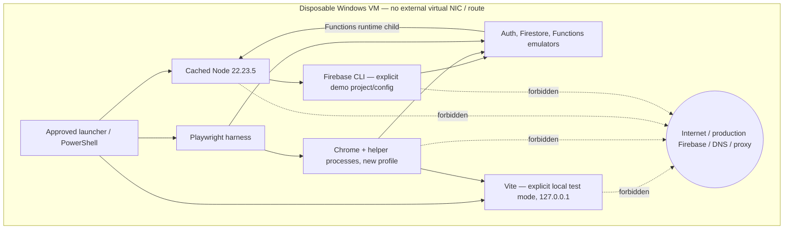

# CaseTrack — Phase 3E-1 Production Isolation Hardening Design

**Phase:** 3E-1, Option A — planning only  
**Prepared:** 16 November 2026 (Asia/Kolkata)  
**Disposition:** **BLOCKED for implementation readiness**  
**Scope:** Read-only technical design and preflight. This report does not authorize implementation, emulator startup, synthetic account creation, seeding, or authenticated testing.

## 1. Executive summary

The future workflow can be designed with enforceable, layered isolation, but the present environment is **not ready to implement or run it**. The strongest host-preserving boundary is a disposable Windows VM whose virtual network adapter is absent, with all test processes, browser, Vite server, Firebase CLI, and emulators running inside that guest. Guest loopback remains available to the test stack, while the guest has no IPv4 or IPv6 route to external networks. A pre-provisioned Windows Sandbox with networking disabled is a fallback only if its feature state, networking policy, required tools, and enforcement can first be demonstrated. Neither mechanism was confirmed available in this preflight.

The current host has Windows 10 Pro 22H2/build 19045 x64, Node 24.22.0, Firebase CLI 15.28.1, Playwright 1.64.1, and Chrome 157.0.8103.51. The requested cached Node 22.23.5 executable and its exact path could not be established; checked standard locations and a repository file scan found no such executable. The VM/Sandbox design must not substitute Node 24 or download Node 22. A provisioned, directly callable Node 22.23.5 runtime is a blocking prerequisite.

There is a direct production exposure in the current normal Vite serve mode: it aliases the ordinary production Firebase config and configures a proxy to the production Functions domain. Separate test mode configuration exists, but the existing E2E runner is not a sufficient isolation boundary: it invokes `npx --yes --package=node@22`, uses selected-domain browser interception, and relies on process/environment guards. These controls do not contain arbitrary browser, Node, Firebase CLI, or child-process egress.

The current Git baseline is branch `main`, commit `366675eb6f9c9a75f04ca1f8e43a7e714a729b68`. Before this report, the working tree had one modified tracked file and three untracked reports; all are pre-existing and preserved. No application, Firebase, harness, credential, ADC, or network configuration changes are proposed as completed work. All security controls remain unimplemented and unverified.

## 2. Existing environment evidence

### 2.1 Current observations

| Item | Observed fact | Status / limitation |
|---|---|---|
| OS | Microsoft Windows 10 Pro, version 10.0.19045, build 19045, 64-bit | Observed read-only through OS inventory. |
| Current Node | `v24.22.0` at `C:\Program Files\nodejs\node.exe` | Observed. Not the required runtime. |
| Required Node 22.23.5 | No executable found at checked locations `C:\Users\LENOVO\AppData\Local\Programs\nodejs\node-v22.23.5\node.exe`, `C:\Program Files\nodejs\22.23.5\node.exe`, `C:\Users\LENOVO\AppData\Local\nodejs\node-v22.23.5\node.exe`, or `C:\Users\LENOVO\.cache\node\22.23.5\node.exe`; no matching `node.exe`/`22.23.5` path found in the repository file scan. | **UNKNOWN exact cache path; runtime not found.** Do not download it. The prior reports also recorded that Node 22.23.5 was unavailable at their checked paths. |
| Firebase CLI | `15.28.1`, installed globally through npm; command resolves from `C:\Users\LENOVO\AppData\Roaming\npm\firebase.cmd`, CLI package under `C:\Users\LENOVO\AppData\Roaming\npm\node_modules\firebase-tools`. | Observed. The CLI is not pinned in the root package. Its version invocation emitted an automatic GET to `https://firebase-public.firebaseio.com/cli.json` for CLI metadata. This was not a request to the CaseTrack production project and did not start an emulator. It was unintended during the read-only inventory and is disclosed here. |
| Playwright | `1.64.1` in `e2e/node_modules/playwright`; root package does not declare it. | Observed. Existing package is present; do not invoke package installation or `npx`. |
| Chrome | `C:\Program Files\Google\Chrome\Application\chrome.exe`, version `157.0.8103.51`. | Observed. Existing Chrome processes were present and left untouched. Future test Chrome must be launched as an owned guest process with a new profile. |
| Firebase CLI invocation in current runner | `e2e/run-ui-ux-infrastructure-recovery.ps1` calls `npx.cmd --yes --package=node@22 -- node <firebase.js> emulators:exec ...` twice. | Observed source. This permits package/runtime resolution/download and fails the no-download requirement. |
| Existing Firebase test config | `firebase.ui-ux-local.json`: Auth `127.0.0.1:9198`, Firestore `127.0.0.1:8187`, Functions `127.0.0.1:5003`, UI disabled, `singleProjectMode:false`. | Observed. It does not alone prove the served application or all CLI child processes stay local. |
| Other emulator config | `firebase.json`: Auth `127.0.0.1:9099`, Firestore `127.0.0.1:8080`, Functions `127.0.0.1:5001`; UI disabled; single project mode true. | Observed. Root `.firebaserc` default is the production project. A default must never be relied on by the test workflow. |
| Current Vite configuration | `vite.config.js`: ordinary mode aliases `firebase/firebase-config.js`; the `role-admin-local` serve mode aliases `firebase/local-role-admin/firebase-config.js`. Non-role-admin serve mode configures `/__production-functions` proxy to production Functions. | Observed. Default/normal Vite mode is production-capable. `role-admin-local` omits that proxy. The existing root `dev` command is plain `vite` and does not select the local mode. |
| Emulator/Vite listeners | No listeners were returned for the relevant current ports checked (5173, 5174, 9198, 8187, 5003, 9099, 8080, 5001). | Read-only snapshot only; no process was started/stopped. |
| Current processes | Existing Chrome and Codex/runtime Node processes were present. No Firebase/Vite/Java process was identified in the process-name inventory. | Existing browser/runtime processes were left alone. No process was selected by command line or terminated. |
| Firewall profiles / OS sandbox feature | Firewall profile query yielded no usable profile details. Querying Windows optional feature `Containers-DisposableClientVM` failed because elevation is required. | **UNKNOWN.** No firewall rule or feature state was changed. Windows Sandbox availability is not established. |
| Browser host | Prior Phase 3A report says the CUA browser host was unavailable. Local Chrome/Playwright capability was separately demonstrated in historical Phase 3B. | Historical facts only; no current CUA session was inspected in this phase. |
| Prior ADC-copy incident | Phase 3A reports a Firebase CLI-generated temporary ADC copy and an automatic-review rejection when removal was attempted. | Historical evidence only. This phase did not inspect, locate, open, copy, or modify any ADC file. Present state is **UNKNOWN**. |

### 2.2 Git baseline

At preflight, before this report was created:

```text
Branch: main
Commit: 366675eb6f9c9a75f04ca1f8e43a7e714a729b68
 M assets/js/cases.js
 M docs/ui-ux-audit/MASTER-UI-UX-ISSUE-REGISTER.md
?? docs/ui-ux-audit/PHASE-3D-A-KEYBOARD-ACCESSIBILITY-VERIFICATION.md
?? docs/ui-ux-audit/PHASE-3D-B-UX-003-FIX-AND-CHECKLIST.md
?? docs/ui-ux-audit/PHASE-3E-AUTHENTICATED-TEST-APPROVAL-PLAN.md
```

Those pre-existing changes were not edited or staged by this phase. The earlier reports cite a different branch and commit; the current preflight values above take precedence for this snapshot.

### 2.3 Evidence reviewed

Reviewed the requested Phase 3 final verification, Phase 3A environment preflight, Phase 3B Playwright smoke test, Phase 3C local UI verification, Phase 3D-A keyboard verification, Phase 3D-B UX-003 report, Phase 3E authenticated-test approval plan, master issue register, and UI/UX implementation checklist. They are treated as dated evidence, not current-state guarantees. Relevant repository source/configuration and the current recovery runner were inspected directly.

## 3. Firebase production-exposure map

### 3.1 Observed initialization and routing paths

| Path | Observed behavior | Production exposure |
|---|---|---|
| `firebase/firebase-config.js` | Initializes Firebase App using a static project configuration; obtains Firestore and Auth. It does not connect either service to an emulator. | Direct browser SDK requests can reach the production project if this module is selected. |
| `vite.config.js` ordinary mode | Alias selects `firebase/firebase-config.js`. The dev server also configures `/__production-functions` to the production Functions host. The root `npm run dev` command does not set a special mode. | **Confirmed high risk:** ordinary local Vite mode loads production Auth/Firestore config and exposes a production Functions proxy path. |
| `firebase/local-role-admin/firebase-config.js` | Requires `MODE === 'role-admin-local'`; initializes with a demo project and calls Auth, Firestore, and Functions emulator connection functions using configured loopback ports. | Safer mode selection, but it has no centralized required environment validation for every endpoint; runtime mode/alias selection still needs an external gate. |
| `assets/js/local-role-admin-endpoints.js` | Supplies local role-admin project ID and port values, with environment-variable overrides for ports. | Malformed/missing/unexpected overrides must be rejected before Vite or Firebase initialization. |
| `firebase/firebase-emulator-config.js` | Requires Vite `MODE === 'test'` and a test project define, initializes Auth/Firestore with fixed local emulator endpoints. It does not initialize Functions in this module. | This particular module is fail-fast for two conditions, but it does not cover the role-admin authenticated path or all three emulator endpoints. |
| `vite.test.config.mjs` | Defines a fixed test project and aliases Firebase config to the emulator config; binds Vite to `127.0.0.1:5184` with strict port. | This is test-oriented but compile-time project substitution is not a network boundary; Functions endpoint and other build modes need independent checks. |
| `assets/js/firebase-functions.js` and `assets/js/firebase-project-policy.js` | In local role-admin mode with the expected demo project, Functions resolves to a loopback endpoint. In production, project policy creates a production Functions URL; non-local development mode routes through the Vite proxy. | Production URL/proxy is intentionally possible outside local mode. Local test mode must prove this path cannot be selected. |
| `e2e/ui-ux.browser.test.cjs` | Checks selected process variables and expected project, then creates emulator-side synthetic accounts/data and launches Playwright. Browser route handler blocks hostnames matching selected Firebase-related suffixes and blocks service workers. | Process guards are useful assertions but not OS-enforced. URL matching is incomplete; non-Firebase domains and uncovered host forms can pass. `page.route` does not isolate Node or CLI traffic and is not a substitute for system egress denial. |
| `e2e/run-ui-ux-infrastructure-recovery.ps1` | Creates a per-process environment, starts local Vite, then invokes Firebase CLI twice through `npx --yes --package=node@22`; runs authenticated/browser and emulator work. | `npx` may resolve/download Node. CLI and its children inherit the host network. The script is not allowed in this phase and must be replaced/hardened in a later approved phase. |
| `firebase.json`, `.firebaserc`, other scripts | `.firebaserc` default points to the production project. Other scripts contain explicit demo checks, but separate production backup/readiness scripts also exist. | A missing `--project`, wrong CLI config, inherited project variable, or wrong script can use the default or select production. Test launcher must always pass an explicit project and config and reject mismatch before child startup. |

The production project identifier is already represented in the repository's production Firebase configuration and policy source. The future launcher should derive the production ID from a narrowly parsed, reviewed source of truth and fail closed if that value cannot be read or if the production config changes shape. It must not read credential stores to identify the project. The test project is separate and explicit, for example `demo-casetrack-ui-audit`, subject to a compatibility check against this repository. The test ID must be rejected if it equals the derived production ID, is missing, or does not match the required demo identifier policy.

### 3.2 Required mode and endpoint policy

The future launcher must require an explicit test mode and project ID before it starts any app or CLI process. It must require all three emulator host/port pairs (Auth, Firestore, Functions), validate loopback-only host values, valid distinct ports, and reject URL schemes/hosts that resolve outside loopback. Missing, malformed, duplicate, or production endpoint values cause a nonzero exit before any Firebase SDK initialization, Vite startup, CLI startup, account operation, or test navigation.

The test-only Vite configuration must select the emulator config by explicit mode, bind Vite only to `127.0.0.1`, use strict fixed ports, disable all production proxy configuration, and avoid the root `.firebaserc` default by passing both `--project <demo-id>` and the dedicated emulator config to Firebase CLI. No production project selection or silent fallback is permitted. Build-time `import.meta.env` values are inputs to validation, not proof of isolation: the launcher must validate before Vite builds/serves, and the browser must assert served runtime metadata before authentication.

### 3.3 Browser, Node, CLI, and child-process paths

Browser SDK calls use the app configuration and emulator connections; an omitted emulator connection or production app selection can produce direct remote requests. Node-side Firebase Admin calls in the E2E harness inherit project and emulator environment variables; they can discover ADC or attempt credential discovery if code/configuration unexpectedly requires it. Firebase CLI may check/update metadata or behave differently across versions, and emulator startup creates child processes. Vite plugins/configuration can proxy requests. `npx` can access a package registry and launch a downloaded runtime. Every layer currently has a potential path to external services outside the local emulator route.

## 4. Proposed layered isolation architecture

### Layer A — Explicit test configuration

Create a dedicated test-only config schema with required values for:

- Explicit test project ID, recommended `demo-casetrack-ui-audit` after compatibility review.
- Auth, Firestore, and Functions emulator endpoints, each explicitly set to `127.0.0.1:<port>`.
- Explicit Vite test mode and Vite origin/port.
- Explicit Chrome executable path and new per-run browser profile.
- Explicit cached Node executable path, resolved and verified to report exactly `v22.23.5`.

Before launching anything, validate project ID syntax and demo prefix, compare to production ID derived from the checked-in production configuration source, require all endpoints, reject non-loopback endpoints, reject production Firebase URL strings in all test config inputs, and require the expected Vite mode. A failure prints a short non-secret error and exits nonzero. No value defaults from `.firebaserc`, production config, ambient Vite mode, registry resolution, or credential state.

### Layer B — Application and runner fail-closed checks

1. Launcher preflight validates the isolated-VM state, test config, exact Node version/path, local dependencies, Chrome path/version, free test ports, and credential-related environment-variable *presence only*.
2. Runner validates before Firebase CLI, Vite, emulator, fixture, or browser process creation. It must ensure no `GOOGLE_APPLICATION_CREDENTIALS`, `FIREBASE_TOKEN`, credential-bearing `FIREBASE_CONFIG`, or other credential selection variable is set in the test process environment. It must not echo variable values.
3. Vite starts only in the dedicated local test mode, with a test config file and no production proxy. A served-config preflight checks project identity and all emulator endpoint metadata before browser launch.
4. Browser page bootstrap checks test project plus all emulator endpoints before login or Auth SDK use. Harness guards must run before account creation/Firestore seeding and before authenticated navigation.
5. Any mismatch, parse error, unavailable endpoint, unexpected credential prompt/error, isolation-control failure, or nonzero child exit aborts the run. It does not retry using another project, default config, online service, downloaded runtime, or ADC.

These are application-level gates only. They do not prove network isolation.

### Layer C — OS network isolation

#### Primary: disposable VM with no external virtual network adapter

Use a disposable Windows VM with all test processes inside the guest and no external, bridged, NAT, default-switch, or host-proxy network adapter. Verify guest adapter inventory and routing tables before launch; verify there is no external IPv4 default route and no IPv6 external route. Loopback is intrinsic to the guest and is sufficient for Vite, Chrome, Firebase CLI and emulators running together. The test runner, Chrome, Firebase CLI, emulator child processes, DNS clients, and arbitrary spawned children all inherit the guest's lack of an external network path; process names are irrelevant to the boundary.

This preserves unrelated host networking because no host firewall/routing/DNS setting is changed. Provision the guest and copy in already available repo/dependencies/runtime/browser only after a later approval. Do not download anything. Mount the source read-only where practical; put run outputs and temporary state in a unique guest-owned workspace. No shared host browser profile or host credentials. Hypervisor management is outside the guest test boundary; host-to-guest file sharing must be narrowly scoped and disabled after the run.

The VM is acceptable only after the owner/operator can prove that it has no usable external NIC/routes and the full test stack can run with the required already-cached Node 22.23.5 and local dependencies. VM product, privileges, current availability, and pre-provisioning state are **UNKNOWN** in this environment. A VM with a NAT/bridged adapter is not an acceptable substitute.

#### Fallback: Windows Sandbox with networking disabled

Windows Sandbox can provide a disposable boundary if the Windows feature is enabled and the `.wsb` configuration explicitly disables networking, with no host credentials or writable shared folders exposed. Run the same adapter/route checks inside the sandbox, then prove loopback service connectivity and controlled egress denial. Keep all test processes inside the sandbox. Sandbox feature state was not established because the read-only feature query required elevation; Windows Sandbox is therefore **not confirmed available**. Since Node 22.23.5 was not found, Sandbox cannot be used to obtain it; its contents must be pre-provisioned from already approved local assets without network access.

#### Other mechanisms considered

| Mechanism | Technical assessment for this use | Decision |
|---|---|---|
| Windows Filtering Platform (WFP) policy | Can enforce packet filtering at OS networking layers, but an application allow/deny policy must cover every relevant binary, service, runtime, and child process, including dynamic child paths and updates. Loopback exceptions, IPv4/IPv6, DNS, proxy traffic, and policy tampering need explicit validated rules. It requires privileged policy management and can affect unrelated traffic if scoped incorrectly. | Not selected as primary; host configuration changes and complicated child coverage undermine the preferred host-preserving boundary. Could be a separately engineered, owner-approved alternative with independent enforcement verification. |
| Windows Defender Firewall rules | Program/path rules can constrain named executables but process-name-only rules are inadequate; Node child processes and Chrome helpers need correct path coverage. Rule precedence, active profiles, outbound defaults, IPv4/IPv6, DNS/proxy, local subnet exceptions, and existing policy/GPO must be verified. Broad outbound blocks risk unrelated apps. | Not sufficient merely because rules exist. Not selected. Do not add global rules in this plan. |
| Windows Sandbox, networking enabled | Does not deny external traffic. | Rejected. |
| Browser request interception only | Controls only requests handled by that browser context and routing API; does not govern browser background traffic, all WebSockets/service workers, Node, Firebase CLI, DNS, or children. | Defense in depth only. |
| Host proxy variables / hosts file / DNS changes | Can be bypassed by direct IP, alternate DNS, IPv6, nested proxies, or child overrides; global host effects. | Rejected as a primary boundary. |

**If neither the no-adapter VM nor a networking-disabled Sandbox can be made available and independently proven, the design remains BLOCKED. Do not weaken the requirement to selected-domain blocks, process-only firewall rules, or browser interception.**

### Layer D — Playwright browser controls (defense in depth)

Use a new browser context and disposable profile; launch the installed Chrome binary explicitly inside the isolated guest. Set `serviceWorkers: 'block'`; block all requests except the exact local Vite origin and approved loopback emulator endpoints; deny all other schemes/hosts, including `file:`, browser extension, WebSocket, and unexpected localhost ports. Close popups and pages not created by the harness; record attempted blocked destinations with redacted host/path metadata. Do not reuse a user's Chrome profile. Verify page request, WebSocket, service-worker, popup, and browser console events.

The route handler remains a second check only. Browser startup/background traffic, DNS resolution before route handling, WebSockets, browser helper processes, and unhandled protocols can escape request interception. It cannot stop Node's HTTP/TCP clients, Firebase CLI metadata checks, functions emulator children, or a process spawning another executable. The VM/Sandbox boundary is the control that denies external routes.

### Layer E — Credential and ADC isolation

The workflow must operate with synthetic emulator-only state and no ADC. The launcher creates a sterile guest environment with a unique empty per-run home/profile and explicit isolated `APPDATA`, `TEMP`, `TMP`, and cloud-SDK config locations. It checks presence (without printing values) of credential selectors such as `GOOGLE_APPLICATION_CREDENTIALS`, `FIREBASE_TOKEN`, and `FIREBASE_CONFIG`; it refuses to start if set and does not inspect their files. In the child environment those variables are absent. It must not invoke `gcloud auth`, Firebase login, production admin SDK calls, or a command that requires credentials.

Network-denied emulator use is the ultimate safeguard against metadata credential discovery resulting in an external request. A credential-required error, ADC discovery warning, CLI attempt to generate a credential copy, or any unexpected authentication prompt stops the run immediately before test-account or Firestore data operations. Logs record only the error class/message after redaction; no environment dumps, credential paths, tokens, project secrets, auth headers, or response bodies are retained. Artifact allowlists exclude home directories, `.config`, `.firebase`, `gcloud`, Firebase CLI cache, temporary credential paths, profile data, and files matching credential/ADC naming patterns. The existing temporary ADC copy remains entirely untouched; its present location/state is unknown.

## 5. Process and network boundary diagram

All named runtime processes are to run inside the isolated guest. No test child is allowed to launch on the host.



### 5.1 Process inventory

| Process | Parent / launcher | Required destinations | Allowed network | Forbidden destinations | Environment and lifecycle |
|---|---|---|---|---|---|
| PowerShell test launcher | VM login/session; manually invoked by approved owner | None | Guest loopback only as needed for readiness | All external IPv4/IPv6, DNS, proxies, production Firebase | Sterile environment; owns every child PID/job; exits on any validation/control failure. |
| Node 22.23.5 runtime — launcher/Vite/test | Launcher starts exact executable path directly; no `npm`, `npx`, `corepack`, or shim | Vite `127.0.0.1:<vitePort>`; local CLI/emulators | Guest loopback only | Registry, public internet, production endpoints, DNS/proxy | Exact executable/version asserted before use. Launcher owns Node children; stop only recorded run-owned PIDs/job. |
| Firebase CLI | Direct Node invocation by launcher, explicit `--project demo-casetrack-ui-audit --config <test-config>` | Emulator loopback and its own local control ports | Guest loopback only | Firebase production, CLI metadata, auth/login, registry, Google APIs, DNS/proxy | No credential selectors; config/project explicit. Launcher owns CLI and emulator descendants. |
| Auth/Firestore/Functions emulators | Firebase CLI; Java or Node child processes as required by CLI | Guest loopback between emulator processes | Only explicit loopback endpoints; ports bound to `127.0.0.1` | External services and metadata endpoints | CLI is lifecycle owner; do not kill by process name. Capture exact descendant PIDs before graceful stop. |
| Vite | Launcher starts `node.exe <repo>\node_modules\vite\bin\vite.js` with explicit test config/mode | `127.0.0.1:<vitePort>` | Guest loopback only | Production Functions proxy, all external routes | No production proxy; `--host 127.0.0.1 --strictPort`. Launcher owns process and captured descendants. |
| Playwright harness | Launcher starts exact Node executable and local harness path | Vite origin and required emulator endpoints | Guest loopback only | Package registries, production Firebase, external URLs | Existing local Playwright package resolved by explicit path; no `npx` or package manager. Runner owns browser context and process. |
| Chrome and helpers | Playwright harness | Vite origin and loopback emulators | Guest loopback only | Internet, DNS, proxies, production Firebase | Installed Chrome path, fresh profile, no user profile/extensions; Playwright closes browser and launcher verifies exit. |
| Functions emulator runtime child | Firebase CLI / Functions emulator | Emulator-to-emulator guest loopback only | Guest loopback only | External services and metadata endpoints | Inherits sanitized environment; CLI owns lifecycle. |

The no-adapter guest boundary applies regardless of process name, binary path, parentage, DNS settings, proxy variables, or whether a new child process is created. The guest must be verified to lack an external IPv4 route and IPv6 route; loopback checks must still pass. Do not attach a temporary external adapter to obtain packages or runtimes.

## 6. Negative test specifications — design only

No test in this section was run. For egress tests, future ISO-03 must use only owner-controlled harmless probe endpoints (controlled DNS name plus IPv4/IPv6 TCP or HTTPS sink), never production Firebase. A negative DNS test must use a controlled authoritative name and capture sink/resolver evidence; a random nonexistent name cannot prove isolation. Positive loopback tests use only the local test stack. Common stop rule: any unexpected external success, project/config mismatch, credential prompt/access attempt, unowned process/listener, or unclear evidence stops the entire run before accounts/data are created. Common rollback: close only run-owned guest processes and discard the disposable guest; preserve host network state.

| ID | Preconditions | Future test method | Expected result | Evidence to capture | Stop condition | Rollback |
|---|---|---|---|---|---|---|
| NEG-001 | Disposable isolated guest; no services started | Supply the production project ID to launcher config. | Rejected before Firebase initialization or child startup. | Redacted launcher exit/error; process tree showing no child start. | Any Firebase/App/CLI process starts. | Remove only the test-owned config copy; discard guest if state is uncertain. |
| NEG-002 | Disposable guest and test config copy | Omit required demo project ID. | Fail closed before Vite, CLI, Firebase SDK, account, or data operations. | Validation error and empty run-owned process/listener inventory. | Any service or data operation begins. | Restore only disposable config copy; discard guest if uncertain. |
| NEG-003 | Disposable guest | Omit each required emulator endpoint in turn. | Each omission rejected before app/CLI initialization. | Per-endpoint error and process inventory. | Any omitted endpoint is silently defaulted or a process starts. | Restore only config copy. |
| NEG-004 | Isolated guest; no production targets | Configure an unavailable loopback emulator port. | Readiness fails and test exits; no remote fallback or retry. | Refused loopback connection, exit code, no external sink traffic, process cleanup. | Any non-loopback retry or account/data operation. | Stop only run-owned children; discard guest if cleanup ownership is unclear. |
| NEG-005 | ISO-02 boundary proven; controlled harmless external probe | From fresh Chrome context, request controlled external HTTPS and WebSocket destinations. | VM boundary denies; sink records no successful connection. | Browser event log; guest route inventory; controlled sink logs; packet/drop evidence. | Any handshake/HTTP success or missing evidence. | Close test-owned Chrome; remove its fresh profile in guest. |
| NEG-006 | ISO-02 boundary proven | Node test process attempts controlled external TCP/HTTPS and direct-IP connection. | Connection denied; no successful sink record. | Node exit/error, sink logs, guest network inventory. | Any successful connection or any credential/production destination. | Stop test-owned Node process; discard guest if uncertain. |
| NEG-007 | ISO-02 boundary proven | Spawn a test-owned child executable/process to attempt the same controlled probe. | Child remains subject to boundary; denied. | Parent/child PID tree, child result, sink logs. | Child escapes guest or egress succeeds. | Stop recorded child tree only; discard guest. |
| NEG-008 | Controlled DNS name and controlled IPv4/IPv6 sinks; ISO-02 proven | Attempt controlled DNS lookup and IPv4/IPv6 external probes; inspect guest adapters/routes. | No external resolution path or communication; no IPv4/IPv6 external route. | Adapter and route tables, controlled DNS logs, IPv4/IPv6 sink logs. | Any external route, resolution reaching a resolver, or sink success. | Disable/discard guest; do not alter host routes. |
| NEG-009 | Controlled proxy sink outside guest; ISO-02 proven | Set dummy inherited HTTP/HTTPS/ALL proxy variables in disposable child; run both proxy and direct probes. | Proxy cannot connect and direct route remains denied. | Redacted env *names only*, child results, proxy sink logs, network evidence. | Proxy succeeds or secret value appears in logs. | Clear variables in disposable child only; discard guest if state uncertain. |
| NEG-010 | Disposable VM/Sandbox; no test app running | Remove/disable an isolation prerequisite in a disposable clone/config, then invoke launcher. | Launcher refuses before starting app/test processes. | Control preflight result, process tree, guest adapter state. | Launcher starts any app/test process despite failed control. | Restore/discard only disposable clone/config. |
| NEG-011 | Fake credential requirement implemented without real credentials/files | Stub a harmless test dependency to request credentials; no ADC path or real token is supplied. | Runner stops before credential file lookup, credential access, account creation, or network fallback. | Stub output, redacted error class, filesystem-access audit if available. | Any credential file is opened or real credential path is accessed. | Discard guest and stub state; existing ADC remains untouched. |
| NEG-012 | Required runtime available in guest; registry access disabled by ISO-02 | Inspect launcher and run process with package-manager shims that fail if invoked; verify exact Node executable. | Cached Node 22.23.5 is used directly; no `npx`, package install, or runtime download. | Executable path/version, process tree, shims, no registry sink traffic. | Any package manager/download path is used or runtime version differs. | Stop owned processes; discard guest. |
| NEG-013 | Services started only in a later approved phase; loopback-bound | Connect approved local clients to the configured Auth, Firestore, Functions, and Vite endpoints. | Only listed `127.0.0.1` endpoints succeed; external probes remain denied. | Listener owner/address, loopback request logs, controlled external sink logs. | Any listener binds non-loopback or egress succeeds. | Stop only exact run-owned service tree; discard guest if ownership uncertain. |
| NEG-014 | Full test-owned tree recorded; unique VM/run identifiers | Run normal cleanup and simulate interrupted cleanup in disposable clone; compare host and guest process/network state. | Only test-owned processes/resources are removed; host networking and unrelated processes remain unchanged. | Before/after host network summary, guest PID ownership, resource IDs, VM discard/restore evidence. | Any unrelated PID/rule/network setting is changed or ownership is ambiguous. | Discard VM; restore only specifically named test-owned VM resources; no broad rule deletion. |

## 7. Positive safety test specifications — future, separate approval

Each item is a future test specification only. It requires ISO-01 and ISO-02, all test dependencies already available locally, and a later approval that specifically permits emulator startup and synthetic data. Stop on any mismatch; clean only the run-owned guest/process tree.

| ID | Future check | Expected evidence/pass condition |
|---|---|---|
| POS-001 | Launcher explicitly selects `demo-casetrack-ui-audit` and rejects derived production ID | Captured sanitized config summary and preflight result; no default project resolution. |
| POS-002 | Auth, Firestore, Functions endpoints bind to configured loopback address/ports | Listener inventory identifies expected emulator owner and `127.0.0.1` address only. |
| POS-003 | Auth Emulator reachability | Local readiness/auth emulator request succeeds; no external route observed. |
| POS-004 | Firestore Emulator reachability | Local readiness and synthetic test-only read/write succeed in the emulator; record IDs are synthetic and scoped to run. |
| POS-005 | Functions Emulator reachability | Local test callable reaches emulator and expected synthetic response; no production Functions URL. |
| POS-006 | Exact cached Node execution | Process executable path and `node --version` prove the pre-existing cached Node is `v22.23.5`; no shim/package manager. |
| POS-007 | Isolated Chrome launch | Chrome executable/path/version, fresh profile location, guest PID ownership, and successful close are recorded. |
| POS-008 | Local Vite navigation | Test page loads only from `http://127.0.0.1:<approved-port>` with role-admin/test mode metadata and no production proxy. |
| POS-009 | Synthetic authentication | Synthetic account is created only in fresh Auth Emulator, authenticates, and is deleted as part of run cleanup. |
| POS-010 | Synthetic Firestore read/write | Synthetic record is written/read/deleted only in fresh Firestore Emulator; no production data. |
| POS-011 | Screenshot capture | PNGs decode; metadata contains no credentials or user data; output stored in run-owned artifact directory. |
| POS-012 | Complete cleanup | Every owned process exits; listeners/temp/profile/data/artifact handling matches approved retention; guest discarded; host network and unrelated processes unchanged. |

## 8. Proposed file-level changes (not implemented)

### A. Test harness changes

| Exact path | Current responsibility | Proposed change | Security effect / regression risk | Tests and rollback |
|---|---|---|---|---|
| `e2e/run-ui-ux-infrastructure-recovery.ps1` | Current multi-step runner starts Vite and invokes CLI via `npx` twice; it creates a temp runtime and runs emulator/browser work. | Replace with an explicit preflight-first launcher: require proven isolated guest, exact Node path/version, test project/config/endpoints, dependencies and ports; strip credential selectors without reading values; start direct Node executable only; capture owned descendants; fail closed and clean only owned resources. Remove all `npx` usage. Keep authenticated/data operations gated behind a later separate approval and runtime mode. | High security effect. Medium/high regression risk due lifecycle/CLI differences and emulator startup semantics. | NEG/POS specs, process ownership tests, syntax/format checks. Roll back by restoring the reviewed prior launcher from version control only after owner approval; preserve unrelated changes and never restore unsafe npx path as an active entry point. |
| `e2e/ui-ux.browser.test.cjs` | Authenticated UI checks, synthetic account/data setup, selected hostname browser interception. | Require validated project + three endpoints + Vite origin; assert served config before Auth; block every non-approved origin/protocol/WebSocket; redact logs; no seeded operations until separately approved; preserve request interception as defense in depth. | High safety effect. Regression risk for current routes and browser APIs. | NEG-001–009, POS-001–011. Revert only approved test harness diff. |
| `e2e/package.json` and `e2e/package-lock.json` | Declare Playwright `^1.58.2`; lock resolves Playwright 1.64.1. | Keep exact installed package; ensure all future launch commands resolve local module by explicit path and never call npx or install. If a script alias is added, it must use the approved direct launcher. | Prevents runtime/package download path; small harness compatibility risk. | Static search asserting no `npx`/package-install path; revert only script/metadata change. |

### B. Test-only configuration

| Exact path | Current responsibility | Proposed change | Security effect / regression risk | Tests and rollback |
|---|---|---|---|---|
| `firebase.ui-ux-local.json` | Local emulator ports and Firestore/Functions source/rules. | Use a distinct, reviewed test-only copy with explicit `127.0.0.1` endpoints, dedicated demo project passed by CLI, strict single-project policy where compatible, and no UI/network exposure. Do not change this existing config until separately approved. | Reduces accidental project/port ambiguity; risk of emulator incompatibility if single-project semantics differ. | POS-001–005 and NEG-003/004; remove only uniquely named test copy. |
| Proposed `e2e/casetrack-isolation.config.json` | Does not exist. | Add schema for explicit project ID, three loopback endpoints, Vite mode/origin, Node path, Chrome path and unique run ID. No credentials or secrets. | Makes all required inputs visible and validateable; config drift risk. | Schema negatives NEG-001–004/012; remove only test-only file. |
| Proposed `e2e/run-isolated-ui-ux.ps1` | Does not exist; current runner has npx/host execution. | Add a narrow launcher for the disposable VM/Sandbox. Validate boundary state before any service process; direct executable paths; explicit child environment; exact PID ownership and cleanup. | Main orchestration enforcement; high implementation complexity. | All negative/positive tests; delete only new launcher on rollback. |
| `firebase/local-role-admin/firebase-config.js`, `assets/js/local-role-admin-endpoints.js` | Existing dedicated local role-admin Firebase config and endpoint constants. | Add required configuration validation or route test workflow through a new isolated config module that validates before SDK initialization. Require all three endpoints and explicit demo project; reject production ID/URL. | Closes missing-variable and silent-fallback paths; risk to existing role-admin local workflow. | NEG-001–004, POS-001–005; revert only isolated guard/config additions after approved diff. |

### C. Application source changes, if unavoidable

| Exact path | Current responsibility | Proposed change | Security effect / regression risk | Tests and rollback |
|---|---|---|---|---|
| `vite.config.js` | Selects production Firebase config for ordinary mode and defines production Functions proxy outside `role-admin-local`. | Prefer no production source change if a separate test-only Vite config can fully select local modules. If not, add a narrow fail-closed test mode that rejects missing/production project configuration and has no proxy. Never change normal production behavior silently. | Can prevent mode confusion, but carries high production-build/dev regression risk. | Mode matrix/build tests, NEG-001/002, production config regression. Roll back only the dedicated test-mode change. |
| `firebase/firebase-config.js` | Initializes production Auth and Firestore. | Avoid changing unless import graph proves a guard cannot be provided in test-only config. If unavoidable, fail closed for explicit test mode before `initializeApp`, without changing production initialization semantics. | Strong guard at source boundary; high regression risk because this is shared production config. | Production config/unit/build regression plus NEG-001/002. Exact rollback requires owner review and scope-limited revert. |
| `assets/js/firebase-functions.js`, `assets/js/firebase-project-policy.js` | Resolve production/local Functions endpoint. | Avoid change if isolated Vite config proves the production helper unreachable. Otherwise explicitly reject test mode unless project is demo and Functions emulator is configured. | Prevents production endpoint selection under test mode; medium/high regression risk. | Endpoint policy tests, static served-bundle scan, NEG-001/003. Revert only test guard. |

### D. OS isolation configuration

| Exact path/resource | Current responsibility | Proposed change | Security effect / regression risk | Tests and rollback |
|---|---|---|---|---|
| Proposed unique VM definition `CaseTrack-UIUX-ISO-<run-id>` or Windows Sandbox `.wsb` file | No dedicated VM/Sandbox config established. | Create disposable VM without any external vNIC; fallback `.wsb` must explicitly set networking disabled. Record original VM/feature state, adapter inventory, guest routes, and unique owner/run ID. Avoid host firewall/routing/DNS/hosts edits. | Provides process-agnostic network boundary; VM resource/storage/privilege requirements remain unknown. | NEG-005–010, NEG-013/014; delete/discard only exact run-owned VM/Sandbox resource. |
| Guest-only workspace/runtime/artifact directories | Not yet created for this design. | Unique run-scoped dirs for `HOME`, app data, temp, Firebase CLI/gcloud config, browser profile and outputs; exclude credentials from mounts/artifacts. | Prevents ambient host credential discovery and cross-run leakage. | NEG-011/012/014, POS-006–012; remove only validated run-specific directories inside discarded guest. |

### E. Documentation

| Exact path | Current responsibility | Proposed change | Security effect / regression risk | Tests and rollback |
|---|---|---|---|---|
| `docs/ui-ux-audit/PHASE-3E-1-ISOLATION-HARDENING-DESIGN.md` | This read-only design/preflight report. | Deliver current findings, test specifications, approvals and blockers. | Documents status and prevents design being mistaken for verified implementation. | Review for exact scope and evidence; rollback only this report if owner requests. |
| Later Phase 3E implementation and execution reports | Not created. | Record approved actions, actual control proof, negative/positive test evidence, cleanup and residual risks in separately approved phases. | Keeps planning and runtime claims distinct. | Approval matrix below; no implementation report is created now. |

## 9. Rollback and recovery design

No rollback action was executed. The future implementation must make every resource uniquely attributable to a run and prove original state restoration.

| Mechanism | Prerequisite and original-state record | Apply and enforcement proof | Partial failure / interrupted run | Reversal and restoration proof |
|---|---|---|---|---|
| Disposable VM (primary) | Owner-approved hypervisor and privileges; record VM ID, adapter list, switch attachment, snapshot/creation time, guest OS and repo/dependency/runtime provenance. | Create uniquely named disposable guest with no external adapter; verify guest adapters/routes and controlled egress sink denial; verify loopback services only after later approval. | Launcher owns child PIDs/jobs. If VM crashes, disconnect/discard only that uniquely named VM; do not kill host processes based on name. Check host inventory for no changed adapters/rules and no lingering shared mounts. | Shut down and delete/discard only the run-owned VM/snapshot and temporary artifacts per retention approval. Re-enumerate host adapters/routes/firewall summary and compare to recorded baseline; unrelated host processes stay untouched. |
| Windows Sandbox fallback | Feature enabled and verified; owner approval; record feature state, `.wsb` file hash/settings, mapped folders, clipboard/printer settings and host network summary. | Launch unique sandbox with networking disabled, no credential mounts, minimal read-only source mapping; inside verify no external adapters/routes and test loopback. | On crash, Sandbox disposal removes guest. Do not modify host firewall/routes. Check mapped folders and host processes. | Close/discard only that Sandbox session and delete only its unique `.wsb` file/temp workspace if authorized. Verify original optional-feature state and host network/process baseline unchanged. |
| WFP/Firewall alternative (not selected) | Separate explicit approval; elevated access; baseline export/read of relevant profile/policy, rules, GPO ownership, IPv4/IPv6/DNS/proxy routes, and exact binary paths. | Add only unique, narrowly scoped rule/filter identifiers for all relevant processes/children and loopback exceptions. Independently prove filter enforcement from outside and inside test processes. | Any rule ambiguity, precedence issue, child path mismatch, or control failure stops launcher. Never issue broad rule deletion/reset. | Remove only exact unique IDs created for this run; verify IDs absent and compare profiles/rules/routes with saved baseline. This alternative is not authorized or recommended in this phase. |
| Test config and launcher | Approved patch reviewed; preserve current file hashes/diffs and pre-existing dirty tree. | Add only uniquely named test config/launcher artifacts; capture exact file list and diff. | If launch fails, stop before services; keep diagnostic output redacted. Do not restore whole repository or discard user changes. | Revert only the approved diff/new named files; verify git status shows only pre-existing baseline entries and intended report. |
| Processes and local endpoints | Unique run ID, parent/child PID mapping, executable path, start time, bound port inventory. | Start direct executable children with captured process handles/job ownership; bind only guest loopback. | On interruption, reconcile exact PIDs/descendant tree and listeners. Stop only confirmed run-owned processes. If ownership cannot be proven, discard guest rather than kill unrelated host processes. | Verify all owned PIDs exited and owned listeners closed; leave unrelated processes untouched. |

Recovery after crash: do not rerun automatically. First identify the exact VM/run ID and owned processes; verify the host network/credential state was not changed; discard the guest if process ownership or partial writes are uncertain; preserve redacted logs only. No broad `Stop-Process`, firewall reset, rule deletion by display name, or global network cleanup is acceptable. The historical temporary ADC-copy issue requires a separately approved cleanup path; this report neither inspected nor changes it.

## 10. Security acceptance criteria

The first label describes the **design**; the runtime control is not verified in Phase 3E-1.

| Criterion | Design status | Current runtime status / evidence |
|---|---|---|
| Explicit non-production Firebase project required | DESIGN SATISFIED | REQUIRES IMPLEMENTATION; current configs contain fixed demo IDs but no unified launcher contract. |
| Production project rejected | DESIGN SATISFIED | REQUIRES IMPLEMENTATION; current normal Vite mode selects production config. |
| No default-project fallback | DESIGN SATISFIED | DESIGN GAP in current workflow because `.firebaserc` default is production and CLI always needs explicit `--project`; future launcher must enforce. |
| All emulator endpoints explicitly configured | DESIGN SATISFIED | REQUIRES IMPLEMENTATION; existing local role-admin config contains three fixed ports, but launcher contract does not require all endpoint variables. |
| Missing configuration fails closed | DESIGN SATISFIED | DESIGN GAP across complete workflow; isolated modules have partial guards only. |
| Browser outbound internet denied | DESIGN SATISFIED by no-adapter VM design | REQUIRES IMPLEMENTATION and REQUIRES TESTING; interception is currently only defense in depth. |
| Node outbound internet denied | DESIGN SATISFIED by no-adapter VM design | REQUIRES IMPLEMENTATION and REQUIRES TESTING. |
| Firebase CLI outbound internet denied | DESIGN SATISFIED by no-adapter VM design | REQUIRES IMPLEMENTATION and REQUIRES TESTING; CLI metadata request occurred during this inventory. |
| Child-process outbound internet denied | DESIGN SATISFIED by guest boundary | REQUIRES IMPLEMENTATION and REQUIRES TESTING. |
| IPv4 external routes denied | DESIGN SATISFIED in proposed no-adapter guest | REQUIRES TESTING. |
| IPv6 external routes denied | DESIGN SATISFIED in proposed no-adapter guest | REQUIRES TESTING. |
| DNS/proxy escape paths controlled | DESIGN SATISFIED in proposed no-adapter guest | REQUIRES TESTING with controlled sink; current host/test setup not proven. |
| Required loopback communication preserved | DESIGN SATISFIED conceptually | REQUIRES IMPLEMENTATION and REQUIRES TESTING. |
| No ADC dependency | DESIGN SATISFIED | REQUIRES IMPLEMENTATION and REQUIRES TESTING; historical temp ADC-copy issue remains unresolved/unknown. |
| Cached Node 22 used directly | DESIGN SATISFIED as requirement | DESIGN GAP / BLOCKER: executable not found; exact path UNKNOWN. |
| No runtime/dependency downloads | DESIGN SATISFIED | DESIGN GAP in current runner because it uses `npx --yes --package=node@22`. |
| Isolation failure prevents startup | DESIGN SATISFIED | REQUIRES IMPLEMENTATION and REQUIRES TESTING. |
| Cleanup affects only test-owned resources | DESIGN SATISFIED | REQUIRES IMPLEMENTATION and REQUIRES TESTING. |
| Unrelated host networking remains unaffected | DESIGN SATISFIED by disposable guest design | REQUIRES TESTING with before/after host-state evidence. |
| Rollback procedure documented | DESIGN SATISFIED | Not executed; future implementation requires approval and evidence. |
| Negative tests specified with measurable evidence | DESIGN SATISFIED | REQUIRES TESTING; tests are specifications only. |

No row claims a runtime control is VERIFIED. `DESIGN GAP` flags an observed current weakness; `REQUIRES IMPLEMENTATION`/`REQUIRES TESTING` means the future control is only a proposal.

## 11. Owner approval matrix

Every status remains **PENDING**. Approval of this planning report is not implementation or test authorization.

| Approval ID | Proposed action | Exact scope | Prerequisites | Risk | Expected side effects | Rollback | Evidence required | Status |
|---|---|---|---|---|---|---|---|---|
| ISO-01 | Test-only launcher and configuration changes | New isolated launcher/config and narrowly scoped E2E harness/local Firebase config guards; no app/business logic by default. | Approved exact file diff; Node 22.23.5 path identified; no-download dependency inventory; test project/endpoints agreed. | Medium/high due orchestration and mode selection. | New test-only files/config; no host network or credential changes. | Revert only approved paths/diff; preserve pre-existing working tree changes. | Static config validation, runner negative checks, diff review, process-tree design. | **PENDING** |
| ISO-02 | OS-level network isolation implementation | One disposable no-external-NIC VM as primary, or verified networking-disabled Sandbox fallback; no global host firewall/routing edits. | Hypervisor/Sandbox capability and privileges established; exact original-state record; runtime/dependencies available offline. | High if boundary is misconfigured. | Temporary isolated VM/sandbox; host networking expected unchanged. | Discard only unique test-owned resource; compare host state to baseline. | Adapter/route inventory, controlled egress sink evidence, IPv4/IPv6/DNS/proxy/child checks, loopback pass. | **PENDING** |
| ISO-03 | Isolation negative-test execution | NEG-001–NEG-014, including controlled harmless egress probes, in disposable environment only. | ISO-01 and ISO-02 implemented; owner-controlled harmless probe endpoints; no production target; stop/rollback contacts/process defined. | Medium/high; test deliberately checks denied egress. | Probe attempts and temporary local logs only; no actual production Firebase contact. | Stop and discard run-owned guest; remove only test-owned artifacts. | Per-test evidence, sink logs, guest adapter/route state, process ownership and cleanup proof. | **PENDING** |
| ISO-04 | Temporary isolation resource cleanup | Exact VM/Sandbox IDs, test-only files/temp dirs, run-owned processes and listeners. | Resource inventory and baseline captured; owner confirms retention policy. | Low/medium; incorrect scope could affect unrelated resources. | Deletes only unique run-owned temporary resources. | Do not broad-delete; preserve/recreate only exact named resource from baseline if needed. | Before/after resource IDs, PID/listener inventory, host network comparison. | **PENDING** |
| ISO-05 | Any unavoidable application-source change | Only if test-only alias/config cannot prevent normal production-config import; paths initially `vite.config.js`, Firebase config/policy files as identified in §8C. | Concrete diff and import-path proof; production behavior regression plan; separate explicit approval. | High because shared production initialization/build paths are affected. | Potential development/build behavior change. | Revert only approved source diff; prove production mode and test mode after rollback. | Mode matrix, build/unit coverage, NEG-001/002, static served bundle check. | **PENDING** |

Later emulator startup, synthetic account creation, Firestore seeding/deletion, authenticated navigation, screenshot capture, and route testing require a separate phase-specific approval. They are not requests in this report.

## 12. Residual risks

- A VM/Sandbox configuration can be misdescribed or mis-provisioned; independent adapter, route, and harmless controlled-sink evidence is mandatory.
- Host-to-guest file sharing, clipboard, shared profile, hypervisor integration, or a guest proxy can provide unintended paths or expose host data; minimize/disable sharing and use a read-only source mapping where practical.
- Firebase CLI and Firebase SDK behavior can change by version. Pin and record existing CLI/library versions; deny egress even if the CLI attempts update/credential checks.
- Current local Firebase modules are not uniformly governed by one strict test-mode contract. A wrong Vite alias can initialize production Auth/Firestore before browser route guards execute.
- Test project IDs and emulator project behavior must be verified against current Firebase CLI/Functions code expectations.
- A stale listener or orphan emulator child can collide with later runs. Cleanup requires PID ancestry/handle ownership, not process-name matching.
- Firebase Functions emulator may invoke project discovery, runtime downloads, or credentials if local runtime dependencies/config are incomplete. All required local artifacts must be verified before startup; network remains denied.
- Browser instrumentation cannot observe or prevent every browser/network behavior; OS boundary remains required.
- Test artifacts, crash dumps, CLI logs, and browser profiles can contain synthetic PII or accidental secrets. Use synthetic-only data, minimize logs, redact, and enforce artifact allowlists/retention.
- Existing host firewall state and Windows Sandbox feature state were not established. No inference about their enforcement is made.
- The prior ADC-copy incident is not resolved by this plan; its contents and current state remain uninspected.

## 13. Blocking prerequisites

1. Identify and verify the **existing cached Node 22.23.5 executable path** without installing or downloading a runtime. Current evidence shows only Node 24.22.0 on PATH and no Node 22.23.5 at checked locations.
2. Establish an available disposable VM with no external vNIC, or prove Windows Sandbox networking-disabled capability and required local assets. This preflight could not establish the Sandbox feature state without elevation; VM availability is also unknown.
3. Demonstrate offline availability of all required existing dependencies, Firebase CLI, Java/Functions runtime needs, and Chrome inside the isolated guest. No downloads are allowed.
4. Approve ISO-01 and ISO-02 before implementation. Approve ISO-03 separately before any probes.
5. Review the current production Firebase ID source and agree a dedicated demo project value and all three loopback ports. The current `.firebaserc` default is production and must not be used.
6. Resolve the historical temporary ADC-copy incident through an explicitly approved mechanism before any later run that could cause CLI credential-copy behavior. Do not read or modify that file as part of this plan.
7. Make a future test-only configuration fail closed before any Firebase App initialization, account creation, seeding, or authenticated navigation.

Until these prerequisites and the OS boundary are independently evidenced, design readiness is **BLOCKED**. If the required cached Node cannot be found or no strong isolated guest is available, do not implement a weaker host-firewall/domain-list alternative.

## 14. Recommended next implementation phase

After the owner explicitly approves ISO-01 and ISO-02, the next phase should first inventory/provision offline prerequisites and implement only the test-only launcher/configuration plus the isolated guest boundary. It should stop before starting emulators, creating accounts, seeding data, or opening authenticated pages. Once ISO-03 verifies negative controls and ISO-04 confirms cleanup, a separate approval can authorize emulator startup, synthetic fixtures, and authenticated UI verification. ISO-05 is required only if test-only routing cannot prevent production initialization; it needs its own concrete diff and approval.

**Recommended disposition for this report: acknowledge design findings, resolve the blockers above, and leave every approval PENDING.** No request is made here for emulator startup or authenticated testing.

## 15. Phase 3E-1 action record

- No application source changed.
- No test harness source changed.
- No Firebase configuration or `.firebaserc` changed.
- No firewall, routing, proxy, DNS, or hosts-file setting changed.
- No emulator or Vite service was started or stopped.
- No authenticated Playwright test, account creation, or Firestore seeding was executed.
- No CaseTrack production Firebase project or production endpoint was accessed.
- No ADC file was opened, copied, or modified; no credential environment variable was changed.
- No software was installed and no runtime was downloaded.
- Existing processes and pre-existing Git changes were preserved.
- **Unintended read-only CLI metadata request:** while recording the installed Firebase CLI version, the CLI performed its automatic metadata check against `firebase-public.firebaseio.com`. It was not a CaseTrack production Firebase access, but it was an external network request and is recorded as a preflight side effect. No negative network test was run.
